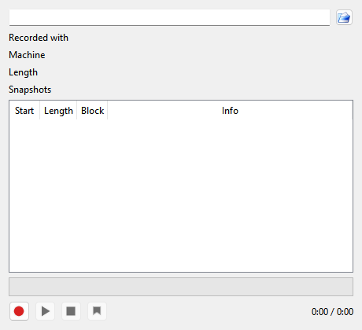
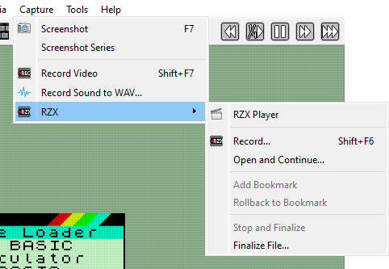

# Screenshots and recording

The **Capture** menu saves what the machine shows and plays: still pictures, video, sound,
and RZX recordings of a game as it is played.

## Screenshots

```{index} Screenshot, Screenshot Series
```

```{index} see: screen capture; Screenshot
```

**Capture > Screenshot** (F7 in both hotkey presets) saves the picture as a file. The message
**screenshot saved** appears in the corner of the picture.

**Capture > Screenshot Series** takes several screenshots in a row, a set number of frames
apart. Use
**Capture > Screenshot** while a series runs to stop it.

The files go into the screenshots folder, named after the time they were taken:
`xpeccy_153012_250.png` is 15:30:12 and 250 ms.

### Screenshot settings

```{index} Screenshot; format, Screenshot; folder, No border, SCR, Hobeta, PNG
```

The **Screenshots** group on the **Video** page of **Options**:

- **Output** - the folder for the files; the {icon}`fileopen` button beside it picks one.
  Your home folder by default.
- **Format** - the kind of file, see below.
- **Combo** ... **each** ... **frames** - how many pictures **Screenshot Series** takes, and
  how many frames apart.
- **No border** - the screen only, without the border around it.

| Format | What is saved |
|---|---|
| **PNG**, **BMP**, **JPG** | the machine's picture at the window's size, without the shader |
| **SCR** | the 6912 bytes of the machine's screen memory, to load back on a Spectrum |
| **Hobeta** | the same screen memory as a Hobeta file (`.$C`), which goes onto a TR-DOS disk as `screen` |

**SCR** and **Hobeta** hold only the standard Spectrum screen: a picture made in another
video mode does not fit in them.

## Video

```{index} Record Video, video
```

**Capture > Record Video** starts a video, and the same command again stops it. While it
records, a blinking sign in the top right corner of the picture says so; the sign is not in
the video. When the recording stops, the message **video saved:** names the file.

The video has the picture and the sound together, in an MP4 file by default. It is made by
FFmpeg, a free program that is not part of Xpeccy+.

### Getting FFmpeg

```{index} FFmpeg, Get FFmpeg
```

Xpeccy+ looks for FFmpeg in the `ffmpeg` folder inside the
[settings folder](getting-started.md#where-the-settings-are), then wherever your system
finds programs (and on macOS in Homebrew's folders). To use another copy, give its path in
the **FFmpeg** field of the **Recording** group; leave the field empty to let Xpeccy+ find it.

When FFmpeg is not found, **Record Video** opens the **Get FFmpeg** window instead (the
{icon}`arrow-down` arrow button beside the **FFmpeg** field opens it too):

- **Windows** - downloads a ready-made FFmpeg (about 190 MB) into the settings folder and
  checks it. {icon}`arrow-down` **Get latest** downloads the newest release,
  {icon}`arrow-down` **Get previous** downloads the one before it. Take the previous one if
  your graphics driver is not new: with an old driver the newest release cannot use the
  graphics card to encode.
- **Linux** - installs the distribution's `ffmpeg` package; the system asks for your
  password.
- **macOS** - installs it with Homebrew. When Homebrew is not installed, the window says
  where to get Homebrew.

When the window says **FFmpeg ... is ready**, close it and use **Record Video** again.

### Recording settings

```{index} video; settings, RAW frame, Real FPS
```

The **Recording** group on the **Video** page of **Options**:

- **Source** - **RAW frame** records the machine's picture alone, with no shader and no
  indicators. **Screen** records the window as you see it, shader and all.
- **Scale** - how many times bigger the video is than the machine's picture, from
  **Scale x1** to **Scale x8** (for **RAW frame** only).
- **Real FPS** or **50 FPS** - **Real FPS** records at the machine's own frame rate, which
  on most machines is a little different from 50. **50 FPS** records at exactly 50 frames
  per second, and the sound is adjusted to match.
- **Output** - the folder for the videos; your system's videos folder by default.
- **FFmpeg** - see [Getting FFmpeg](#getting-ffmpeg).

The size and frame rate of the video are shown beside these settings. The **Border**
setting of the **Picture** group changes the size too.

```{index} Recording: Advanced Settings, video; codec, MP4, MKV, NVENC
```

{icon}`settings` **Advanced settings** opens **Recording: Advanced Settings**:

- **Video** - **Container** (**MP4** or **MKV**), **Codec**, **Preset** (slower makes a
  smaller file, but can slow the machine down), **Quality (CRF)** (lower is better; 18 looks
  lossless), **Color**, and **Blend up to 60 fps**. The codecs are **H.264** and **H.265**,
  **AV1** and the graphics card encoders (**NVENC**, **AMF**, **QSV**) when your FFmpeg and
  computer can use them, and **FFV1, lossless**, which is always saved as MKV.
- **Sound** - **Codec** (**Auto**, **AAC** or **Opus**) and its bit rate. **Keep pitch at
  50 FPS** keeps the notes in tune when **50 FPS** speeds the sound up a little.
- **File name template** - the name of the video file; the name it gives right now is shown
  under it.
- **Auto recording** - see below.
- **FFmpeg** - **Extra options** for the encoder, **Video override** and
  **Sound override** to replace the options Xpeccy+ sets, and the whole FFmpeg command as
  it will run.

```{index} File name template, video; file name
```

The file name template can contain these keys:

| Key | Becomes |
|---|---|
| `%d` | the date, `20260929` |
| `%t` | the time, `153012` |
| `%image` | the name of the file in use (snapshot, tape, disk or divMMC card), or the machine's name when there is none |
| `%machine` | the machine's name |

The default is `xpeccy-plus_%d_%t_%image`. The name is made when the recording stops, so
`%image` is the last file that was in use.

### Auto recording

```{index} Auto recording, Autostart at, Autostop at
```

**Auto recording** starts and stops a video by itself, to catch a demo or a game from its
first frame.

- **Autostart at** - starts a video when the condition is met: **Code in RAM** (the first
  program code the machine runs from RAM, which is where a loaded program starts), or the
  CPU reaching an address: **PC ==**, **PC >=** or **PC <=**, with the address beside it
  (`#8000`, `$8000`, `0x8000` or `32768`). A video is started this way once after each
  reset. When you turn this on in Options, it waits for the next reset.
- **Autostop at** - stops any video, including one started by hand: at a **Reset**, or
  when the CPU reaches an address as above.

**Record Video** used by hand always overrides these settings: after a video is started or
stopped by hand, auto recording does not start one again until the next reset.

The **?** button lists the command-line switches for recording:

- `--video-out <file>` - record from the start into this file; `.mp4` or `.mkv` picks the
  container.
- `--video-auto`, `--no-video-auto` - turn auto recording on or off for this run, with the
  conditions set in Options.
- `--video-autostart <at>`, `--video-autostop <at>` - the conditions for this run: `ram`,
  `reset`, or an address such as `==#6000` or `">=#8000"`.

They hold for that run only. See [Command line](command-line.md).

## Sound to WAV

```{index} Record Sound to WAV, WAV; recording sound, sound; recording
```

**Capture > Record Sound to WAV...** asks for a file and writes everything the machine
plays into it, until you choose the command again. The file is 16-bit stereo, at the
**Rate** set on the **Sound** page of **Options**. The messages **start WAV output** and
**stop WAV output** confirm it. `--wav-out <file>` on the command line records from the
start.

## RZX recordings

```{index} RZX
```

An RZX file records a game as it is played: the machine's state at the start and every key
press and joystick move after it. Played back, it repeats the game exactly, frame for frame,
on any program that plays RZX. It is much smaller than a video. Players use it to show a
long game played to the end, or how a hard part of a game is done.

### Playing an RZX

```{index} RZX Player, RZX; playing
```



Open an `.rzx` file with **File > Open...**, or with the {icon}`fileopen` button in the
**RZX Player** (**Capture > RZX > RZX Player**). It plays on the machine it was recorded on.
The **RZX Player** shows:

- **Recorded with**, **Machine**, **Length** and **Snapshots** - what the file says about
  itself. For files made by Xpeccy+, **Recorded with** also tells how many rollbacks and how
  much slow motion were used while recording.
- the list of the file's blocks, with **Start**, **Length**, **Block** and **Info**; the
  part being played is marked. Double-click a row to go there.
- the progress bar and the time; click the bar to go to that point.
- {icon}`tape-rec` **Record**, {icon}`tape-play` **Play / Pause**, {icon}`tape-stop` **Stop**,
  and {icon}`rzx-bookmark` **Add a bookmark to roll back to**.

### Recording an RZX

```{index} RZX; recording, Add Bookmark, Rollback to Bookmark, Stop and Finalize, bookmark; RZX
```



**Capture > RZX > Record...** asks for a file and starts recording from the machine's
current state. A blinking sign in the corner of the picture shows that recording is on. The
file is saved every 30 seconds, so a crash does not lose the game.

{icon}`tape-rec` **Record** in the **RZX Player** during playback starts recording from
that point instead: the new recording keeps everything played so far and goes on from the
current frame.

While you record:

- **Add Bookmark** - remember this point. A bookmark added while the machine is paused is
  set when the machine runs again.
- **Rollback to Bookmark** - go back to the last bookmark, or to the start when there is
  none, and play on from there; what was recorded after that point is thrown away.
  [Rewind](time.md) takes the recording back the same way.
- **Stop and Finalize** - end the recording and save it without the bookmarks: this is the
  file to share.

```{index} Open and Continue, Finalize File
```

Ending the recording any other way - **Record...** again, {icon}`tape-stop` **Stop** in the
player, opening another RZX file or switching machines - saves it with its bookmarks, so
you can go on with it later. **Open and Continue...** is how you go on:
it opens a recording, runs it to its end at full speed, and records on from there; you are
asked for the file to record into, with the same file offered.

**Finalize File...** removes the bookmarks from a recording saved earlier, without playing
it.
