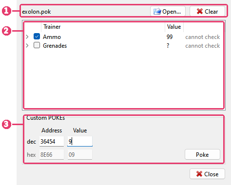

# Cheats

```{index} Cheats, cheat, POKE, trainer, .pok
```



1. The cheat file in the window. **Open...** reads another one, **Clear** turns every cheat
   off and empties the window.
2. Its trainers. A tick turns one on.
3. **Custom POKEs** - pokes of your own, one byte at a time.

**Tools > Cheats** opens the window. It works while the machine runs: a tick changes the
machine's memory at once, and there is nothing to apply.

## Cheat files

```{index} .pok; finding, POKES folder
```

A cheat file (`.pok`) holds trainers: infinite lives, more time, a level to start on. Each
trainer is a few pokes - bytes written into the game's memory. Game archives often carry
one in a `POKES` folder beside the tape or snapshot.

Open one as any other file: **File > Open**, a drop onto the picture, **File > Recent**, or
the command line. The Cheats window opens with it. Opening a cheat file does not reset the
machine or replace anything in it.

When you open a tape, snapshot or disk, Xpeccy+ looks for its cheat file by itself:
`POKES\NAME.pok` beside the image, then `NAME.pok` beside it, where `NAME` is the image's
name. The file goes into the window with nothing ticked, and the window says
**(found beside the image)**. Opening an image without one takes such a file out of the
window again; a file you opened yourself stays.

A file that is not a cheat file at all is refused with a message.

## Turning a trainer on

```{index} Cheats; does not match this release, Cheats; Value
```

Tick a trainer to poke it into the machine. Untick it, and the bytes it changed are put
back as they were.

Some trainers ask for a value, such as the number of lives. A **?** in the **Value**
column marks them: ticking one asks for the number, from 0 to 255 (`#` for hex). Click the
value to change it while the trainer is off.

The column after it says what the window knows about the trainer:

- **does not match this release** - the file says which bytes the trainer changes, and
  memory holds others. The file is for another release of the game, or the game has not
  loaded yet. Ticking it asks before poking.
- **cannot check** - the file does not say what the bytes were, so there is nothing to
  compare. The trainer is poked when ticked.
- **needs 128K** - it pokes a memory page this machine does not have.
- **no RAM there** - it pokes an address where the machine has ROM now.
- **bad:** and a line number - that part of the file cannot be read. The trainer cannot be
  ticked.

Click the arrow before a trainer to see its pokes: the address, the value, and what was
there before if the file says. A poke for a 128K page goes into that page, whatever page
the machine has in its memory at the moment.

## Custom POKEs

```{index} Custom POKEs, POKE; custom
```

Type an address and a value, as BASIC's `POKE` takes them: in decimal on the **dec** row, or
in hex on the **hex** row under it. Typing in one fills in the other. The row without the
cursor is dimmed.

Enter in **Address** goes on to **Value**. Enter in **Value** pokes the byte, moves the
address on by one and keeps the value ready to be typed over, so a run of bytes goes in one
after another. **Poke** does the same as Enter.

The address is the one the processor sees, with the memory paged in now. An address in ROM
is refused.

Every byte poked this way goes into the **Custom** row of the list. Untick it to put the
original bytes back, last first; tick it to poke them again. **Clear** at the top empties
it, with the cheat file.

## When cheats go off

```{index} Cheats; reset, Cheats; Rewind, Cheats; RZX
```

A reset, opening a file, a machine switch, **Quick Load** and **Undo Quick Load** turn every
cheat off and write nothing back: the memory they changed is gone. The cheat file stays in the window.

**Rewind** keeps cheats on: a trainer whose bytes are back to the originals after going
back in time is poked again. One whose bytes are something else goes off.

An RZX recording takes in each cheat turned on or off, so it plays back the same. While an
RZX plays, the window does not poke.

Cheats last until the program closes. A snapshot saved while a cheat is on has the poked
bytes in it.

**Cheats** has no key by default: set one on the **Hotkeys** page of **Options**, under
**Tools**. The toolbar can have it too: right-click the toolbar, **Buttons > Tools**.
