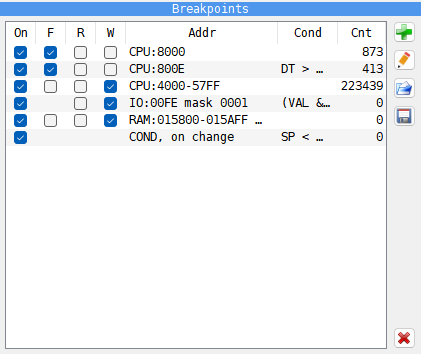
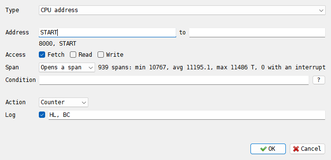
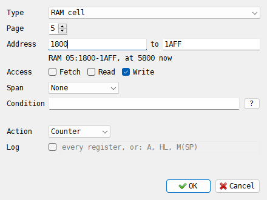
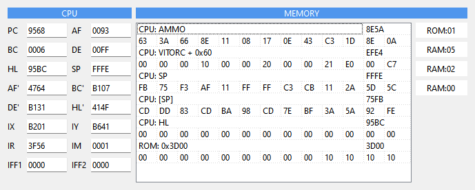
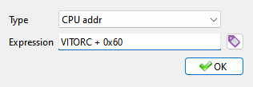

# Breakpoints and watching

```{index} breakpoint
```

```{index} see: watchpoint; breakpoint
```

A breakpoint tells the machine to stop at a place or on an event: when the CPU runs an
instruction at an address, reads or writes a memory cell, uses a port, gets an interrupt,
or when an expression comes true. Instead of stopping, a breakpoint can also count, save
the screen or write a line to the breakpoint log, and two of them can time the code between
them. The **Watcher** window and the watched ports show values while the machine runs.

Breakpoints work while the machine runs. A step taken in the Debugger does not stop on one
(see [Running and stepping](debugger.md#running-and-stepping)).

## Kinds of breakpoint

```{index} breakpoint; CPU address, breakpoint; I/O port, breakpoint; RAM cell, breakpoint; ROM cell, breakpoint; Slot cell, breakpoint; Interrupt
```

| Kind | Stops when |
|---|---|
| **CPU address** | the CPU uses an address, whatever memory page is there |
| **I/O port** | the CPU reads or writes a port |
| **RAM cell** | the CPU uses a byte of RAM, wherever that page is mapped |
| **ROM cell** | the CPU uses a byte of ROM, wherever that page is mapped |
| **Slot cell** | the CPU uses a byte of the cartridge |
| **Interrupt** | the CPU gets an interrupt request |
| **Condition (global)** | an expression comes true; no address |

```{index} breakpoint; Fetch, breakpoint; Read, breakpoint; Write
```

A memory breakpoint has three flags, and any of them can be on:

- **Fetch** - the CPU is about to run the instruction there. The machine stops before it
  runs, with the instruction under the cursor in the listing.
- **Read** - the CPU reads the byte as data.
- **Write** - the CPU writes the byte.

A port breakpoint has **Read** (IN) and **Write** (OUT). A read, write or port breakpoint
stops after the instruction that did it has run to its end.

**CPU address** and **RAM cell** differ on a machine that pages its memory. A breakpoint
on CPU address `C000` stops whatever page is at `C000`. A breakpoint on a RAM cell stops
only for that byte of that page, at whatever address the page is seen.

## Setting breakpoints from the listing

```{index} breakpoint; setting
```

The quickest way is a key on a line of the **Disasm** listing. Each key switches its
breakpoint on and off again. The keys are the same in both presets:

| Key | Breakpoint on the line under the cursor |
|---|---|
| Space | **Fetch**, on the memory cell |
| Shift+Space | **Fetch**, on the CPU address |
| Ctrl+Space | **Write**, on the memory cell |
| Alt+Shift+Space | **Read**, on the memory cell |

A line with a breakpoint is drawn in its own color. The keys can be changed on the
**Hotkeys** page of **Options**, as **Disasm: Breakpoint**, **Disasm: Breakpoint on read**,
**Disasm: Breakpoint on write** and **Disasm: Breakpoint on CPU address** (see
[Hotkeys](hotkeys.md)).

The {icon}`stop` **Breakpoints** button over the listing, and **Breakpoints** in the menu a
right-click on the listing opens, hold **Fetch break**, **Read break** and **Write break**.
They work on the selected block when the cursor is inside it, or else on the line under the
cursor, and make a memory cell breakpoint. To select a block, drag over the lines with the
left button.

In the memory dump, the right-click menu has **Fetch break**, **Read break** and
**Write break** for the byte under the cursor (see [Memory](debugger-memory.md)).

**Debugger: Stop here** - F4 (Modern), F9 (Classic) - lets the machine run until it gets
to the line under the cursor, without a breakpoint in the list (see
[Code and labels](debugger-code.md)).

## The Breakpoints panel

```{index} Breakpoints panel, Reset counter
```



1. The list of breakpoints.
2. The buttons: {icon}`add` add, {icon}`edit` edit, {icon}`fileopen` open a list,
   {icon}`floppy` save the list, and {icon}`cancel` delete at the bottom.

The **Breakpoints** panel is the tab with the stop sign under the memory dump. Each row is
one breakpoint:

| Column | What it shows |
|---|---|
| **On** | a tick: the breakpoint works; no tick: it stays in the list but does nothing |
| **F**, **R**, **W** | the **Fetch**, **Read** and **Write** flags; a port has no **F**, an interrupt and a global condition have none |
| **Addr** | the kind and the address, see below |
| **Cond** | the condition |
| **Cnt** | how many times it fired |

Click a box in the first four columns to switch that flag. Click a column title to sort
the list by it.

**Addr** names the kind of breakpoint:

| Text | Kind |
|---|---|
| `CPU:8000`, `CPU:4000-5AFF` | **CPU address**, an address or a range |
| `IO:00FE mask 0001` | **I/O port**, the port and its mask |
| `RAM:014000 [05:0000]` | **RAM cell**: the place in all of RAM, then the page and the offset in it |
| `ROM:...`, `SLT:...` | **ROM cell**, **Slot cell**, written the same way |
| `IRQ` | **Interrupt** |
| `COND`, `COND, on change` | **Condition (global)** |

Double-click a row of an address, RAM or ROM breakpoint to show that place in the listing;
a RAM or ROM cell shows only while its page is mapped in.

The buttons at the right:

- {icon}`add` add (the plus sign) - opens the **Breakpoint Editor** for a new breakpoint;
- {icon}`edit` edit (the pencil) - opens the selected one in the **Breakpoint Editor**;
- {icon}`fileopen` open (the folder) - loads a list from a `.xbrk` file, in place of the one
  you have;
- {icon}`floppy` save (the floppy disk) - writes the list to a `.xbrk` file;
- {icon}`cancel` delete (the red cross, at the bottom) - removes the selected breakpoints.

The right-click menu of the list has:

- **Reset counter** - sets **Cnt** of the selected breakpoints back to 0, together with the
  hit count that `HITS` reads and what their spans measured;
- **Open breakpoint log** - opens the [breakpoint log](#the-breakpoint-log) in the
  program your system opens `.log` files with. It is grayed out until the log is written.

Hold the mouse over the row of a breakpoint that opens a span to see what the span
measured (see [Spans](#spans)).

The list is not kept when the program closes. Save it to a file to use it again.

## The Breakpoint Editor

```{index} Breakpoint Editor
```



The editor shows only the fields the chosen **Type** needs. Here it holds a breakpoint
that opens a span and logs two registers on every hit; the line beside **Span** is what the
span has measured so far.

| Field | What it sets |
|---|---|
| **Type** | the kind: **CPU address**, **I/O port**, **RAM cell**, **ROM cell**, **Slot cell**, **Interrupt**, **Condition (global)** |
| **Page** | the 16K page of a RAM, ROM or slot cell, as a decimal number |
| **Address** ... **to** | the first and the last byte; **to** left empty means one byte. For an **I/O port** they are **Port** and **mask** |
| **Access** | **Fetch**, **Read**, **Write** |
| **Span** | **None**, **Opens a span** or **Closes a span**, see [Spans](#spans) |
| **Condition** | an expression; the breakpoint fires only when it is not 0. Empty means always. **On change** beside it is for a global condition |
| **Action** | what happens when it fires: **Debugger**, **Counter** or **Screen dump** |
| **Log** | also write a line to the breakpoint log every time it fires, and what to write in it |

### Addresses

```{index} breakpoint; address
```

The **Address** fields take a hex number, with or without `#`, `$` or `0x` in front, or a
label name. A label wins over a number written the same way: if there is a label `BEEF`,
`BEEF` is that label and `#BEEF` the number.



A cell of RAM, ROM or the slot can be given four ways:

- an offset in the page, `0000` to `3FFF`, with the page in **Page**;
- the page and the offset together, `05:1800`. The page is hex here, while **Page** counts
  in decimal;
- a CPU address of `4000` or more, such as `5800`: the cell is the one mapped there now, and
  **Page** moves to its page. This works when the memory there is of the kind the type
  watches; otherwise the address is taken as an offset in **Page**;
- a label. For a RAM cell the label brings its page with it.

The line under the fields shows how the address was read: `8000, START` for a CPU address
with its label; `RAM 05:1800-1AFF, at 5800 now` for a cell, or `not mapped now` when its
page is not in the memory at the moment. When it cannot be read, the line says why in red,
such as **the range ends before it starts** or **the end is in another page**, and
{icon}`ok-apply` **OK** does not take it.

```{index} port mask
```

The **mask** of a port says which bits of the 16-bit port address are compared: a 1 bit
must be the same as in **Port**, a 0 bit can be anything. Empty or `FFFF` is one exact
port; `00FF` matches on the low byte; `0001` with port `00FE` matches every even port, which
is every port the Spectrum's ULA answers.

### Condition and Log

```{index} Expression Syntax
```

The line under **Condition** checks the expression as you type it. It shows **ok:** and
the expression as it was understood, with brackets for the priorities and hex numbers with
`0x`; or what is wrong and at which character. {icon}`ok-apply` **OK** does not take a
broken condition. The **?** button opens **Expression Syntax**, a short reference of the
next section.

**Log** has a field beside it, for what a logged hit writes: expressions split by commas,
such as `A, HL, M(SP)`, in the syntax of a condition. Empty, the line has every register.
A wrong expression keeps the editor open, with what is wrong under **Condition**.

Label names are completed as you type in the address fields, **Condition** and **Log**.
{icon}`cancel` **Cancel** closes the editor and changes nothing. Editing a breakpoint keeps
its counters and what its span has measured.

## Conditions

```{index} condition, breakpoint; condition
```

A condition is an expression in the style of C. It is checked when the breakpoint is hit;
the breakpoint fires when the result is not 0. Comparisons and the logical operators give
1 for true and 0 for false.

### Operators

```{index} condition; operators
```

From the one that binds tightest to the loosest; operators in one row have the same
priority and work from left to right.

| Operator | Meaning |
|---|---|
| `( )` | brackets |
| `[x]`, `M(x)` | the word and the byte in memory at x |
| `!` `~` `-` | logical not, invert all bits, negate |
| `x->n` | the byte in memory at x+n |
| `*` `/` `%` | multiply, divide, remainder |
| `+` `-` | add, subtract |
| `<<` `>>` | shift left, shift right |
| `<` `>` `<=` `>=` | compare |
| `==` `!=` `=` | equal, not equal; `=` is the same as `==` |
| `&` | bitwise and |
| `^` | bitwise exclusive or |
| `\|` | bitwise or |
| `&&` | logical and |
| `\|\|` | logical or |

The values are 32-bit numbers with no sign: `-1` is `FFFFFFFF`, so `A - 5 < 0` is never
true. Division by 0 gives 0, so a condition does not start firing when a divisor happens
to be 0. A word in memory is read low byte first, as the Z80 reads it.

### Operands

```{index} condition; operands
```

| Operand | Meaning |
|---|---|
| `A`, `HL`, `BC'`... | a CPU register, see below |
| a name | a label: its address |
| `1234` | a decimal number |
| `0x1234`, `#1234` | a hex number |
| `0123` | an octal number: a leading zero, as in C |
| `'A'` | the code of a character |
| `M(x)` | the byte at x |
| `[x]` | the word at x |
| `RAY(x, y)` | 1 if the beam passed dot x of line y during this instruction |

The registers are `A`, `F`, `B`, `C`, `D`, `E`, `H`, `L` and the same with `'` for the
second set (`A'`, `B'`...); the pairs `AF`, `BC`, `DE`, `HL`, `AF'`, `BC'`, `DE'`, `HL'`;
`IX`, `IY` and their halves `IXH`, `IXL`, `IYH`, `IYL`; `SP`, `PC`, `I`, `R`, `IR`; `IM`,
`IFF1`, `IFF2`. Register names can be typed in either case; label names cannot.

A name is looked up first as a register, then as one of the variables below, then as a
label. So a label that has the name of a register cannot be reached by its name.

A number without a prefix is decimal: `100` is a hundred, `0x100` and `#100` are 256,
`0100` is 64. A bare `FF` is therefore not a number but a name, so hex always needs its
prefix.

### Variables

```{index} condition; RD, condition; WR, condition; MDT, condition; IN, condition; OUT, condition; VAL
```

The last memory or port access of the instruction. Each is `FFFFFFFF` when there was none.

| Variable | Meaning |
|---|---|
| `RD` | the address of the last memory read |
| `WR` | the address of the last memory write |
| `MDT` | the byte of that read or write |
| `IN` | the port of the last IN |
| `OUT` | the port of the last OUT |
| `VAL` | the byte of that IN or OUT |

```{index} condition; DOS, condition; SLOT0, condition; FRAME
```

The state of the machine:

| Variable | Meaning |
|---|---|
| `DOS` | 1 while the TR-DOS ROM is switched in |
| `SLOT0` ... `SLOT3` | the page in the memory window at `#0000`, `#4000`, `#8000` and `#C000`, as the **MEMMAP** panel shows them |
| `FRAME` | frames since the last reset, as the **FRAME** counter of the **MEMMAP** panel |
| `RAYX`, `RAYY` | where the beam is between two instructions, as the **RAY** counter of the **MEMMAP** panel |
| `HITS` | how many times this breakpoint was hit, see below |
| `DT` | T-states since the span opened, or since this breakpoint's hit before, see [Spans](#spans) |

A port is 16 bits wide, and the Spectrum decodes only part of it. `IN` and `OUT` hold the
whole 16 bits, so ask for the keyboard port as `(IN & 0xFF) == 0xFE`, not as one exact
value. When a program always uses the same full port, as 128K paging uses `7FFD`, plain
`OUT == 0x7FFD` is enough.

```{index} condition; RAYX, condition; RAYY
```

`RAYX` and `RAYY` count dots and lines from the first visible one, borders included. The
line is longer than the picture, so a 48K frame is 448 x 312. Use them for a region of
the frame, for example `RAYY == 100 && RAYX >= 200`.

```{index} condition; RAY
```

`RAY(x, y)` is for one exact dot. The beam moves 8 to 46 dots during one instruction, so
`RAYX == 200` is almost never true between two of them; `RAY(200, 100)` asks whether the
beam passed that dot while the instruction ran, and is true once a frame. The machine
stops right after that instruction. Both arguments can be expressions, such as
`RAY(200 + B, RAYY)`. A plain number outside the frame is refused while you type it; a
computed one outside the frame is simply never reached.

### Before or after the instruction

On a **Fetch** breakpoint the registers are read before the instruction runs. On a
**Read**, **Write** or port breakpoint they are read after it.

### HITS

```{index} condition; HITS
```

On a breakpoint with an address, `HITS` counts every hit of it, this one included, whatever
the condition says. `HITS > 30` lets the first 30 hits pass and stops on the 31st.

On a global condition there is no address to count, so `HITS` counts the times the
condition itself fired. It can limit a condition (`HITS < 3` stops the first three times)
but not skip: `PC == 0x8000 && HITS > 30` never comes true, because `HITS` only moves when
the whole condition is true. To let an address pass a number of times, make it an address
breakpoint with the condition `HITS > 30`. The editor warns about this in amber.

### DT

```{index} condition; DT
```

On a breakpoint that closes a span, `DT` is how long that span took, in T-states:
`DT > 12000` in its condition fires only on a pass that ran too long. On any other
breakpoint with an address it is the time since its own hit before. It is 0 when there is
nothing to measure from, such as on the first hit, and on a global condition.

### Good to know

- An address holds one breakpoint, so it has one condition. Join several with `||`.
- A condition that cannot be worked out when it runs, such as one with a label that is no
  longer loaded, fires, so the mistake does not go unnoticed.

### Examples

| Condition | Fires when |
|---|---|
| `A == 5 && [SP] > 0xFF00` | A is 5 and the word on top of the stack is above `FF00` |
| `(BC == 0x1234) \|\| (BC == 0x5678)` | BC holds either value |
| `M(PC) == 0x76` | a HALT is about to run |
| `SP < 0x5B00` | the stack ran down into the screen and system variables |
| `WR >= 0x4000 && WR < 0x5800` | something writes to the screen's pixels |
| `(IN & 0xFF) == 0xFE && (VAL & 0x1F) != 0x1F` | a key is pressed while the keyboard is read |
| `OUT == 0x7FFD && (VAL & 7) == 3` | a 128K program pages RAM page 3 in at `#C000` |
| `SLOT3 == 7` | RAM page 7 is at `#C000` |
| `HITS == 30` | on an address breakpoint: the 30th time it is hit |
| `FRAME == 300` | as a global condition with **On change**: the first instruction of frame 300 |
| `RAYY == 100` | every instruction on line 100; with **On change**, once a frame |
| `RAY(200, 100)` | the instruction during which the beam passed dot 200 of line 100 |
| `DT > 12000` | on a breakpoint that closes a span: the span took more than 12000 T |

## Global conditions and On change

```{index} global condition, breakpoint; Condition (global), On change
```

A breakpoint of type **Condition (global)** has no address. Its expression is checked
after every instruction, so it finds things no single address can: "A became 0 somewhere",
"the stack went below `5B00`".

Out of the box it fires on every instruction while the expression is true, just as the
condition of an address breakpoint does. Tick **On change** to make it fire only when the
expression becomes true: once, and again only after it was false in between. `A == 0`
without **On change** stops on every instruction while A stays 0; with it, only on the
instruction that made it 0.

Several global conditions can come true on the same instruction; each one then does its
own action.

## Actions

```{index} breakpoint; action, Counter, Screen dump
```

| Action | What happens |
|---|---|
| **Debugger** | the machine stops and the Debugger opens |
| **Counter** | the machine goes on; only **Cnt** in the list grows |
| **Screen dump** | the machine goes on; the 6912 bytes of the main screen (RAM page 5) are saved as an `.scr` file |

A screen dump goes into the screenshots folder (the **Output** of the **Screenshots** group
on the **Video** page of **Options**, see [Screenshots](capture.md#screenshots)), named
after the time, such as `xpeccy_153012_250_0.scr`.

## Spans

```{index} span, breakpoint; span
```

```{index} see: timing; span
```

Two breakpoints can time the code between them. Set **Span** of the first to **Opens a
span** and of the second to **Closes a span**. Each time the machine gets to the first and
then to the second, the T-states between them make one span. The opening breakpoint keeps
how many spans there were, the shortest, the average and the longest, and how many of them
had an interrupt in the middle.

- The span is opened and closed on every hit, whatever the condition says. The condition
  and the action decide only whether the hit stops, counts or logs.
- A close takes the span opened last, whichever breakpoint opened it. So spans can nest: a
  routine called from a timed routine can be timed too, each on its own.
- A close with no span open measures nothing.
- A routine with several ways out needs a closing breakpoint on each of them.
- Any breakpoint with an address can open or close a span, and so can **Interrupt**; a
  global condition cannot.

What the spans measured is shown:

- beside **Span** in the **Breakpoint Editor**, for an opening breakpoint;
- when you hold the mouse over its row in the **Breakpoints** panel, such as
  `938 spans: min 10767, avg 11193.0, max 11486 T, 0 with an interrupt`;
- at the end of the breakpoint log, when the program closes, if a breakpoint wrote to it,
  and at the end of a [run with no window](command-line.md#running-with-no-window): one
  line for each opening breakpoint.

```
SPAN START n=10 min=10767 avg=11211.6 max=11487 sum=112116 int=0
```

The line has the breakpoint's label, or its address when it has none, then the number of
spans, the shortest, the average and the longest in T-states, their sum, and how many had an
interrupt.

Spans of the same code differ for a reason: on a Spectrum the CPU waits when it uses the
memory the screen is read from at that moment, so the same loop takes longer while the beam
draws the picture. **Reset counter** in the right-click menu of the list starts them again.

## The breakpoint log

```{index} breakpoint log, breakpoint; log, Open breakpoint log
```

Tick **Log** in the **Breakpoint Editor** and every time the breakpoint fires, a line goes
to the breakpoint log, whatever its action is. With the action **Counter** this logs every
hit without stopping.

The log is a file of its own. It is made at the first hit that logs, with nothing to switch
on first: `xpeccy-plus-<date>-<time>-brk.log`, in `logs/<date>/` beside the program, or in
the **Folder** of the **Log** group on the **Application** page of **Options**. Where that
cannot be written to, it goes to the settings folder. **Open breakpoint log** in the
right-click menu of the **Breakpoints** list opens it; `--brk-log` on the command line
sends it elsewhere (see [Command line](command-line.md#debugging)).

Apart from the date in its first line, the log has no time of day in it, only the
machine's own time. Two runs of the same program give the same lines, so two logs can be
compared line by line.

```
# Xpeccy+ 2026.8 breakpoint log, 2026-10-11 20:46:19
# F frame, T since its interrupt, t since the machine was made, all in T
F00000000 T034459 t=5758 CPU:8006 RAM:02:0006 F n=1/129 stop DT=42 cond=HL == 0x4080 PC=8006 AF=8080 BC=0080 DE=FFFF HL=4080 SP=FFFF AF'=FFFF BC'=FFFF DE'=FFFF HL'=FFFF IX=FFFF IY=FFFF IR=0002 IM=0 IFF1=0 IFF2=0 F=S------- ROMPG=0 RAMPG=0 DOS=0 ROM=1 CPM=0 INT=0
```

| Part | Meaning |
|---|---|
| `F00000000 T034459` | the frame since the last reset, and the T-state in it |
| `t=5758` | T-states since the machine was made |
| `CPU:8006 RAM:02:0006` | where it fired: the breakpoint's own address, then the same place the other way - page and offset for a CPU address, the CPU address for a cell |
| `F` | what was done there: `F` a fetch, `RD 5C3A=FF` a read, `WR 4000=00` a write, `IN=BF` or `OUT=07` on a port |
| `n=1/129` | how many times it fired, and how many times it was hit |
| `stop` | the action is **Debugger**: the machine stopped here |
| `span=open`, `span=close from=START int=0` | the breakpoint opens or closes a span; a close names the breakpoint that opened it and how many interrupts came in between |
| `DT=42` | the value of `DT` |
| `cond=...` | the condition, when there is one |
| `PC=8006 ... IFF2=0` | the registers; PC is the instruction the breakpoint belongs to |
| `F=S-------` | the flags, by letter: S, Z, 5, H, 3, P, N, C |
| `ROMPG=0 RAMPG=0` | the ROM page at `#0000` and the RAM page at `#C000` |
| `DOS=0 ROM=1 CPM=0 INT=0` | the signals of the **MEMMAP** panel |

With expressions in the field beside **Log**, the line has them in place of the registers,
each as written and its value in hex:

```
F00000000 T040188 t=11487 CPU:800E RAM:02:000E F n=1/1 span=close from=START int=0 DT=11487 HL=4100 BC=0000 M(0x4000)=FF
```

An expression that cannot be worked out at that moment is written as `?`.

## Breakpoint files

```{index} .xbrk, breakpoint; file
```

{icon}`floppy` **Save** in the **Breakpoints** panel writes the list to a text file,
`.xbrk`; {icon}`fileopen` **Open** loads one, in place of the list you have. A file can be
written by hand too: one breakpoint a line, its fields split by colons. Lines starting with
`;` are skipped.

```
; Xpeccy+ Debugger breakpoints list
CPU:8000::F:DBG:
CPU:4000-5AFF::W:DBG:
IO:00FE:0001:W:DBG:(VAL & 7) == 2
RAM:05:0000-1AFF:W:CNT:
ROM:00:0038:FL:CNT:
COND:::E:DBG:SP < 0x5B00
CPU:START::FL[:CNT::HL, BC
CPU:DONE::F]:DBG:DT > 11400
```

| Field | What it holds |
|---|---|
| 1, kind | `CPU`, `IO`, `RAM`, `ROM`, `SLT`, `IRQ` or `COND` |
| 2 | `CPU`: the address or a range; `IO`: the port; `RAM`, `ROM`, `SLT`: the page; others: empty |
| 3 | `IO`: the mask; `RAM`, `ROM`, `SLT`: the offset or a range of offsets; others: empty |
| 4, flags | any of `F`, `R`, `W`; `0` switched off; `E` **On change**; `L` **Log**; `[` opens a span, `]` closes one |
| 5, action | `DBG` (**Debugger**), `CNT` (**Counter**) or `SCR` (**Screen dump**) |
| 6, condition | the condition, or empty |
| 7, log | what a logged hit writes: expressions split by commas. Leave it out for every register |

A line can stop after the condition; the last two fields can be empty.

An address in a list is hex without a prefix, as **Save** writes it, or a label of the
labels loaded at the time: `CPU:START`, `CPU:START-DONE`. A label wins over hex written
the same way; `#`, `$` or `0x` in front makes it a number. A RAM label carries its page,
so the page field can be left empty: `RAM::SCREEN_BUF:W:CNT:`. **Save** writes the
addresses as numbers.

A line that cannot be read is left out and named in the log. A condition or a log
expression that does not compile is kept as it is: the condition then fires every time, and
the expression is written as `?`, so the mistake shows.

```{index} --bp, --brk, --brk-log
```

Options of the command line set breakpoints at start (see
[Command line](command-line.md#debugging)):

- `--bp ADR` - a **Fetch** breakpoint on a CPU address or a label;
- `--brk FILE` - loads a `.xbrk` file, added to the ones loaded before it;
- `--brk-log FILE` - writes the breakpoint log to that file, or with `-` to the standard
  output.

The labels of `-l` are loaded first, wherever it stands on the command line. Together with
`--bench` this runs a test from a script with no window, which ends on the first breakpoint
with the action **Debugger** (see
[Running with no window](command-line.md#running-with-no-window)).

## The Watcher

```{index} Watcher, watch
```



The **Watcher** window shows the registers and some places in memory, and follows them
while the machine runs. Open it with **Debug > Watcher** in the main window, or
**Watcher** under the {icon}`other` **Tools** button over the listing.

1. **CPU** - the registers.
2. **MEMORY** - the watches, two rows each.
3. The four memory banks, from `#0000` to `#C000`: ROM or RAM, and the page.

In the picture the game Exolon runs, with a file of labels for it. `AMMO` is its ammo
counter: the first byte, `63`, is 99 rounds. `VITORC + 0x60` is the second frame of its
hero's sprite. `SP` is the stack, and `[SP]` the code the routine will return to.
`0x3D00` is the start of the font in ROM.

Right-click the **MEMORY** list and choose **Add watcher** to add a watch, or
**Delete watcher** to remove the selected one. Double-click a watch to change it.


```{index} Watcher Editor
```



The **Watcher Editor** has:

- **Type** - **CPU addr**, **RAM addr** or **ROM addr**, written before the watch;
- **Expression** - an address, in the same syntax as a condition (see
  [Conditions](#conditions)): `HL`, `0x5C3A`, `IX + 5`, `[0x5C53]`, a label. The
  {icon}`label` button beside it opens the list of labels; a label picked there goes into
  the field.

{icon}`checkbox` **OK** takes it only when the expression is right. The first row of a watch
shows its type and expression, and its value as an address; the second row the 13 bytes that
start at that address. `??` means the expression cannot be worked out at the moment.

The watches are not kept when the program closes.

## Watched ports

The **PORTS** block of the **MEMMAP** panel shows the last value on the ports you choose.
See [Watched ports](debugger.md#watched-ports).

## Examples

### Stop when the program writes to the screen

1. In the **Breakpoints** panel, press {icon}`add` add (the plus sign). The editor opens on
   a **CPU address** with **Fetch** ticked.
2. Untick **Fetch**, tick **Write**.
3. Type `4000` into **Address** and `5AFF` into **to**. The line under them says
   `4000-5AFF`.
4. Press {icon}`ok-apply` **OK** and close the Debugger.

The row says `CPU:4000-5AFF` with a tick under **W**. The first time anything writes to the
screen, the Debugger opens. The machine stops after the instruction that wrote; in the
listing it is usually the line above the cursor.

### Stop when the border color changes

The border color is set by an OUT to the ULA's port, `FE`.

1. In the **Breakpoints** panel, press {icon}`add` add.
2. Set **Type** to **I/O port**.
3. Tick **Write**.
4. Type `00FE` into **Port** and `0001` into **mask**, so every even port counts, as on
   the real machine.
5. Press {icon}`ok-apply` **OK** and close the Debugger.

The row says `IO:00FE mask 0001`. The Debugger opens on every OUT to the port. A program
that makes sound writes the same port all the time, for the speaker; to stop only when the
border turns red, put `(VAL & 7) == 2` into **Condition**.

### Log every call to a routine without stopping

1. In the Debugger, put the cursor on the first line of the routine and press Shift+Space.
2. Select the new row in the **Breakpoints** panel and press {icon}`edit` edit (the pencil).
3. Set **Action** to **Counter** and tick **Log**. To log only some values, type them into
   the field beside it, such as `A, HL, M(HL)`. Press {icon}`ok-apply` **OK**.
4. Close the Debugger.

The machine runs on as before. **Cnt** in the list counts the calls, and every call adds a
line to the breakpoint log. **Open breakpoint log** in the right-click menu of the list
shows it.

### Stop when A is 0 at a given address

1. Put the cursor on the line in the listing and press Shift+Space.
2. Select the new row in the **Breakpoints** panel and press {icon}`edit` edit.
3. Type `A == 0` into **Condition**. The line under it says **ok: (A == 0)**.
4. Press {icon}`ok-apply` **OK** and close the Debugger.

The **Cond** column shows `A == 0`. The machine runs through that line as long as A is not
0, and stops on it, before it runs, the first time A is 0 there.

### Stop on the 50th pass

1. Make a breakpoint on the line as above.
2. Put `HITS == 50` into its **Condition**.

The machine stops the 50th time the CPU gets to the line. **Reset counter** in the
right-click menu of the list starts the count again.

### Time a routine

Here the routine starts at the label `START`, and `DONE` is the last instruction of one
pass.

1. In the **Breakpoints** panel, press {icon}`add` add. Type `START` into **Address**; the
   line under it says `8000, START`. Set **Span** to **Opens a span** and **Action** to
   **Counter**. Press {icon}`ok-apply` **OK**.
2. Press add again. Type `DONE` into **Address**, set **Span** to **Closes a span** and
   **Action** to **Counter**. Press **OK**.
3. Close the Debugger and let the program run for a while.
4. Open the Debugger and hold the mouse over `CPU:8000` in the list.

The tip says how many passes there were and how long they took:
`938 spans: min 10767, avg 11193.0, max 11486 T, 0 with an interrupt`.

To stop on a pass that is too slow, open the `DONE` breakpoint again, set **Action** to
**Debugger** and type `DT > 11400` into **Condition**. The machine stops at the end of such a
pass.

### Check a program from a script

The same two breakpoints, as a file `timing.xbrk`, with the labels of the program in
`timing.lab`. The closing breakpoint also writes `HL` and `BC` to the log:

```
CPU:START::F[:CNT:
CPU:DONE::FL]:CNT::HL, BC
```

```
xpeccy-plus -m zx48 -l timing.lab --brk timing.xbrk --brk-log - -a 0x8000 -f timing.bin --pc 0x8000 --bench 2
```

The machine runs two frames with no window. With `--brk-log -` the log comes to the
standard output, before the speed line and the spans:

```
# Xpeccy+ 2026.8 breakpoint log, 2026-10-11 20:41:36
# F frame, T since its interrupt, t since the machine was made, all in T
F00000000 T040188 t=11487 CPU:800E RAM:02:000E F n=1/1 span=close from=START int=0 DT=11487 HL=4100 BC=0000
F00000000 T051676 t=22975 CPU:800E RAM:02:000E F n=2/2 span=close from=START int=0 DT=11476 HL=4100 BC=0000
...
bench: machine zx48, fast, 2 frames in 0.005 s: 407.0 fps, x8.13 real time, 43.55 ns/T
SPAN START n=10 min=10767 avg=11211.6 max=11487 sum=112116 int=0
```

The exit code is 0. With the action **Debugger** and `DT > 11400` on `DONE`, the run would
stop on the first slow pass and exit with 2, so a script can tell a slow build of the program
from a fast one.
