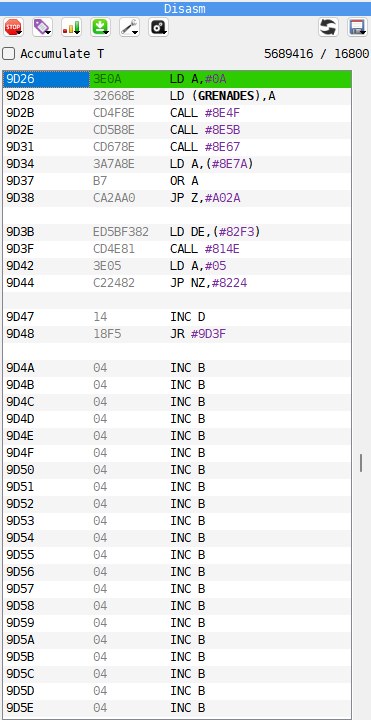
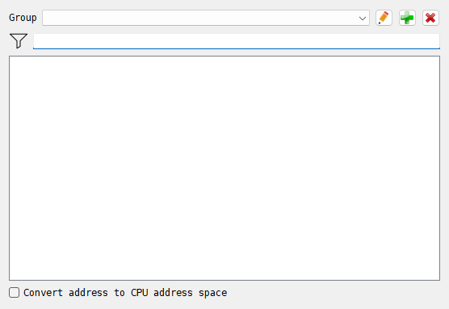
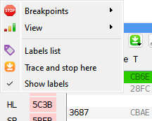

# Code and labels

The **Disasm** panel of the Debugger shows memory as Z80 instructions, the way the CPU
sees it now. You can move through it, change bytes and instructions, give addresses names
and leave comments, and say which parts of memory are data rather than code.

## The Disasm panel

```{index} Disasm panel, disassembly
```

```{index} see: disassembler; Disasm panel
```



1. **Toolbar** - menus of commands, described in [The toolbar](#the-toolbar).
2. **Accumulate T** and the T counter - see [The T-state counter](debugger.md#the-t-state-counter).
3. **Listing** - one row per instruction or line of data.
4. **Scrollbar** - drag it to move through the whole address space.

## The listing

```{index} listing, EQU
```

Each row has four columns:

| Column | What it shows |
|---|---|
| Address | where the row starts in memory |
| Bytes | the bytes of the instruction or data, in hex |
| Command | the instruction, or `DB`, `DW` for data |
| (last) | on the PC row only: the value in memory, or an arrow |

Numbers are hex and start with `#`, as in `LD HL,#5C00`. Where an address has a name, the
name is shown instead of the number: `CALL print_score`. An address a few bytes into a
named place is shown as the name plus the offset: `LD A,(table + 2)`.

Some rows are not instructions:

- a **label** row, in bold on a tinted background, names the address of the row under it;
- a **comment** row, in gray, starts with `;`;
- an `EQU` row follows an instruction when a label points inside it: `NAME` with
  `EQU $-2` says the label is two bytes before the next instruction. Programs that change
  their own code use such labels;
- an empty row follows every return and jump, conditional ones too, to set the blocks of
  code apart. **Block separator** in the {icon}`settings` **Options** menu switches these
  rows off.

The row the CPU will run next, at PC, has its own color. Rows with a breakpoint have their
text in the breakpoint color, and a selected block has its own color too. The colors are
set on the **Debugger** page of **Options**.

The last column says more about the instruction at PC:

- for an instruction that reads or writes memory, such as `LD A,(HL)` or `LD (#5C3A),HL`,
  the byte or word at that address now;
- for a conditional jump, call or return whose condition is met, an arrow: down when the
  jump goes to a higher address, up when it goes to a lower one. The row the jump goes to,
  if that row is in view, gets an arrow too.

## Moving around

```{index} listing; moving around, Go to address, Jump to PC, Set PC, Jump to operand, Return, bookmark; in the listing
```

The listing follows the cursor:

| Key | What it does |
|---|---|
| Up, Down | move the cursor one row; at the edge the listing scrolls by one instruction |
| Ctrl+Up, Ctrl+Down | scroll by one byte, to line up instructions that start elsewhere |
| PageUp, PageDown | scroll one page up or down |
| mouse wheel | scroll by one instruction; with Ctrl, by one byte |

These commands have keys of their own, listed in
[Debugger keys](hotkeys.md#debugger-keys):

- **Go to address** - G in both presets. The address cell of the top row opens for
  typing: type an address and press Enter.
- **Jump to PC** - back to the instruction at PC.
- **Set PC** - PC becomes the address of the cursor row: the CPU goes on from there.
- **Jump to operand** - goes to the address the instruction on the cursor row refers to:
  the target of a `JP`, `JR` or `CALL`, or the address in `LD HL,(#5C3A)`.
- **Return** - goes back to where you were before the last jump. It steps back through
  every **Jump to operand**, typed address, label picked in the **Labels List** and
  register clicked in the **CPU** panel.
- **Bookmark 1** to **Bookmark 5** remember the address at the top of the listing;
  **Go to bookmark 1** to **Go to bookmark 5** take the listing back to that address.
  Bookmarks are not kept when the program closes.

A click on a register's name in the **CPU** panel takes the listing to the address the
register holds. A right-click on the name does the same for the **DUMP** panel (see
[Memory](debugger-memory.md)).

### Typing an address

```{index} address; typing
```

Double-click the address of any row, or select it and press Enter, and type where to go.
The listing scrolls so that the address lands on that row. An address can be:

| You type | It means |
|---|---|
| `8000`, `#8000`, `0x8000` | a hex address |
| `print_score` | the address of a label |
| `@print_score` | the label's address, and never a new label |
| `.HL` | the address a register holds: `.PC`, `.SP`, `.IX` and so on |

A name that is not a label yet makes a new label instead: see
[Labels and comments](#labels-and-comments).

## Editing

```{index} listing; editing, assembler; in the listing
```

Double-click a cell, or select it and press Enter, to change it. Enter applies the change,
Esc leaves the cell as it was.

**Bytes** - type the new bytes in hex, two digits each, with no spaces: `3E05` writes `3E`
and `05` from the address of the row on.

**Command** - type an instruction, such as `ld a,5` or `call #8010`. It is assembled and
written at the address of the row, and the cursor goes down to the next row, ready for
the next instruction. Write hex numbers as `#8010` or `0x8010`: a plain number is decimal.
Labels can be used in the instruction, alone or in a sum: `jp loop`, `ld hl,table+2`,
`ld a,(ix+offset)`. An instruction that cannot be assembled writes nothing, though the
cursor still moves down: check the row before you go on.

You can also type data in the command column:

| You type | It writes |
|---|---|
| `db #3F` | one byte, shown as data |
| `db "SCORE"` | the text, shown as text |
| `dw #4000` | a word, shown as a word |
| `dw table` | the label's address, shown as an address |

```{index} Allow ROM wr, ROM; writing to
```

ROM is protected: changes to a ROM address are not written unless **Allow ROM wr** in the
{icon}`settings` **Options** menu is ticked. A cartridge is never written.

## Labels and comments

```{index} label, comment, label; adding, comment; adding
```

A label is a name for an address. Labels show in the listing on a row of their own and in
place of the addresses in the instructions, and they can be typed wherever an address is
asked for: in the listing, in the **DUMP** panel, in breakpoints.

To add a label, double-click the address of the row and type the name. A name starts with
a letter or `_`, and has no spaces and no `$`. If the row already has a label, that label
gets the new name. A name that reads as a hex number, such as `FADE` or `C0DE`, is taken as
an address: start such a name with `_`.

To add a comment, type `;` and the text in the address cell: `; draws the score`. The
comment shows on a gray row above the address.

To remove a label or a comment, open the address cell of the row it is shown on, clear the
cell and press Enter.

```{index} Show labels, Switch labels, Load labels, Save labels
```

The {icon}`label` Labels menu of the toolbar has:

- **Show labels** - shows or hides the label rows in the listing. The names inside the
  instructions are shown either way. The **Switch labels** key does the same: Ctrl+L in
  both presets.
- **Load labels** - reads a labels file.
- **Save labels** - writes the labels in effect to a file.
- **Labels list** - opens the **Labels List**.

### Labels offered as you type

```{index} label; completion
```

When you type a name in the address or command column, after the second letter a list of
the labels that contain those letters drops down. Enter picks the first one, or pick
another with the arrow keys or the mouse. The same list appears in the
[Breakpoint Editor](debugger-breakpoints.md).

### Label files

```{index} label; file, SjASMPlus, LABELSLIST
```

A labels file holds one label per line: the RAM page, a colon, the address, and the name.
The page is a decimal number, as SjASMPlus writes it. On most ZX machines the pages are 16K:

```
02:8010 print_score
00:DA00 level_data
```

SjASMPlus writes such a file with its `LABELSLIST` directive. Only the offset inside the
page counts, so `02:0010` is the same label as `02:8010`. A line can also leave the page
out, as in `:8010 print_score`: the page is then 5 for an address from 4000 to 7FFF, 2 from
8000 to BFFF and 0 from C000 to FFFF.

On a ZX Spectrum Next the pages are 8K, as in SjASMPlus's `DEVICE ZXSPECTRUMNEXT`:
`17:0010` is offset 0010 in page 17 (MMU value 11 in hex), and `223:0000` is the last page.
Labels in the listing and physical breakpoints belong to those pages. A label used as a CPU
address follows the current MMU mapping; when its page is not mapped, that CPU address is
unknown. A **RAM addr** watch can still read it. A line without a page, such as
`:8010 print_score`, keeps its CPU address regardless of paging.

The pages are read the way the machine in use has them. A file made for a 128K, loaded on
the Next, is read as 8K pages, and the event log warns about it when an offset does not fit.

```{index} CSPECTMAP
```

SjASMPlus's `CSPECTMAP` file loads the same way. Its lines carry each label's address across
all of the RAM, so a label lands on its page on any machine. Values defined with `EQU`
are left out.

```{index} label; set
```

**Load labels** reads a file into a set of labels named after the file, and makes that set
the one in effect. **Save labels** writes the set in effect in the same form. A label in
other memory is saved with that memory's name, as `ROM0:0038` or `DIV3:0010`, and loads
back to the same place. Only Xpeccy+ reads such lines.

Labels typed in the listing go into the set in effect, or into a new set called `noname`
when there is none.

```{index} Auto-load labels, label; loading automatically
```

A program can also come with its labels. With **Auto-load labels** ticked on the
**Debugger** page of **Options**, opening a file also loads the `.labels` file of the same
name from the same folder. These labels are in effect until the next file is opened. See
[Opening a file](files.md). From the command line, `-l` loads a labels file (see
[Command line](command-line.md#debugging)).

### The Labels List

```{index} Labels List, Convert address to CPU address space
```



**Labels list** in the {icon}`label` Labels menu, or in the right-click menu of the listing,
opens the **Labels List**.

- **Group** - the set of labels in effect. The buttons beside it: {icon}`edit` renames the
  set, {icon}`add` adds a new empty set and {icon}`cancel` deletes the set.
- The field under it filters the list: only labels that contain what you type are shown.
  The case of the letters matters.
- The list shows each label's address and name. Double-click a label, or select it and
  press Enter, and the listing goes there.
- **Convert address to CPU address space** - shows where the CPU sees each label now, as
  `CPU:8010`. A label in a page that is not paged in keeps its page and offset.

## Selecting a block

```{index} block; selecting, block; copying as text
```

Many commands work on a block of memory rather than one row:

- drag over the rows with the left button;
- Ctrl+click sets the start of the block, Shift+click its end. Set the start first: a
  Shift+click alone selects everything from 0000;
- a click with the middle button clears the selection.

A block takes in the rows from the first byte of the first row to the first byte of the
last row. The **DUMP** panel shares the same selection. The selection is cleared each time
the Debugger opens.

With a block selected:

- {icon}`bars` **View** marks every byte of the block, if the cursor row is inside the
  block;
- **Disasm to file** saves just the block;
- Ctrl+C copies the block as assembler text, ready to paste into a source file. With no
  block, it copies the cursor row;
- **Fill...** in the {icon}`other` Tools menu opens with the block's start and end filled
  in (see [Memory](debugger-memory.md)).

## How memory is shown

```{index} data; marking memory as, DB, DW
```

Each byte of memory can be marked as code or as one kind of data, and the listing shows it
that way. Select a row or a block, then pick from {icon}`bars` **View** in the toolbar or
the right-click menu:

| Item | Shown as |
|---|---|
| **Opcode** | instructions |
| **Byte** | `DB #3E,#05,...` |
| **ASCII** | `DB "TEXT"`; bytes that are not printable stay `DB #nn` |
| **Word** | `DW #4000,...` |
| **Address** | `DW` with the label of the address, one word a row |

Memory not marked yet is shown as instructions. How many bytes go on a `DB` row, words on a
`DW` row and characters on a text row is set by **DB in row**, **DW in row** and
**Max text length** on the **Debugger** page of **Options**. A label always starts a new row.

The marks belong to the memory itself, not to an address: a mark on RAM page 3 moves with
the page wherever it is paged in. Labels and comments belong to the memory the same way.

```{index} Runtime mapping, Clear mapping
```

**Runtime mapping** in the {icon}`settings` **Options** menu marks memory as the program
runs: every byte the CPU runs as an instruction becomes **Opcode**, and every byte it reads
or writes as data and that has no mark yet becomes **Byte**. It works while the machine
runs, after the Debugger is closed. Play the program for a while, open the Debugger again,
and the data shows as data. **Clear mapping** removes every mark, the ones you set too,
after asking.

The marks, the labels and the comments are kept together in a memory map file: see
[Memory maps](#memory-maps).

## The toolbar

```{index} Disasm panel; toolbar
```

| Button | What is in it |
|---|---|
| {icon}`stop` **Breakpoints** | **Fetch break**, **Read break**, **Write break** for the cursor row or the block. See [Breakpoints and watching](debugger-breakpoints.md) |
| {icon}`label` **Labels** | **Show labels**, **Load labels**, **Save labels**, **Labels list** |
| {icon}`bars` **View** | **Opcode**, **Byte**, **ASCII**, **Word**, **Address** |
| {icon}`arrGreen` **Trace** | running the program step by step, see [The Debugger](debugger.md) |
| {icon}`other` **Tools** | **Search**, **Fill...**, **Sprite scanner** (see [Memory](debugger-memory.md)), **Keyboard**, **Watcher** |
| {icon}`settings` **Options** | how the listing looks and works, see below |
| {icon}`refresh` (circular arrows) | **Reload snapshot & labels** |
| {icon}`floppy` (floppy disk) | **Disasm to file**, **Load dump**, **Save dump**, **Load map**, **Save map** |

A right-click on the listing opens a shorter menu: **Breakpoints**, **View**,
**Labels list**, **Trace and stop here** and **Show labels**.



### The Options menu

```{index} Dim address, Dim opcodes, Syntax colors, Block separator, Show segment
```

- **Dim address** - the addresses in a paler color, so the instructions stand out.
- **Dim opcodes** - the bytes in a paler color. On by default.
- **Syntax colors** - numbers in their own color and labels in bold, inside the
  instructions. On by default. The color is **Const** on the **Debugger** page of
  **Options**.
- **Block separator** - the empty row after each return and jump. On by default.
- **Show segment** - addresses as the memory and page they are in: `RAM:05:0000` is the
  first byte of RAM page 5, `ROM:00:0038` a byte of ROM page 0, and `DIV:` a byte of a
  [divMMC](disks.md#divmmc)'s EEPROM or RAM. Off each time the program starts.
- **Allow ROM wr** - lets the listing, the dump, the filler and a loaded dump write into
  ROM and into a divMMC's EEPROM.
- **Runtime mapping**, **Clear mapping** - see [How memory is shown](#how-memory-is-shown).
- **Reset panel layout** - see [Arranging the panels](debugger.md#arranging-the-panels).

**Dim address**, **Dim opcodes**, **Syntax colors** and **Block separator** are kept
between sessions.

## Saving the listing

```{index} Disasm to file, listing; saving
```

**Disasm to file** in the {icon}`floppy` floppy disk menu writes the listing to a text file
you name: the selected block, or all 64K with nothing selected. The file starts with an
`ORG` line; labels are written as `name:`, comments as they are, instructions after a tab.
An assembler can read the file back.

Ctrl+C copies the same text for the block, without the first line.

## Memory maps

```{index} memory map, XMAP, Save map, Load map
```

A memory map, a `.xmap` file, keeps what you have worked out about a program:

- how each byte of RAM, ROM and a cartridge is shown, code or data;
- every set of labels;
- the comments.

**Save map** and **Load map** in the {icon}`floppy` floppy disk menu write and read it.
Loading a map replaces all label sets and comments. Comments are only kept in a memory map,
never in a labels file, so save a map when you have written comments. A map does not hold
breakpoints: they have a file of their own (see
[Breakpoints and watching](debugger-breakpoints.md)).

From the command line, `--xmap` loads a map at start (see
[Command line](command-line.md#debugging)).

## Reload snapshot & labels

```{index} Reload snapshot & labels, Reload file
```

The {icon}`refresh` button with the circular arrows opens the last file again, the way it
was opened (see [Opening a file](files.md)), and reads again the labels file you loaded.
Then the listing goes to PC. Use it after building a new version of your program: the new
code and its new labels come in with one click. The **Reload file** hotkey does the same;
no key is set for it by default.

## Example: label your own routine

On a 48K, at the BASIC prompt:

1. Open the Debugger: **Tools > Debugger**.
2. Press G, type `8000` and press Enter. The listing starts at 8000.
3. Double-click the command of the 8000 row, type `call #8010` and press Enter. The
   cursor moves to the next row: press Enter, type `ret` and press Enter again.
4. Press G, type `8010` and press Enter.
5. Double-click the address of the 8010 row, type `beep_it` and press Enter.

A bold `beep_it` row now stands above 8010. Go back to 8000: the row reads
`CALL beep_it`. Put the cursor on it and use **Jump to operand**: the listing goes to
`beep_it`. **Return** brings you back.


## Example: mark a table as data

A table of bytes in the middle of the code shows as nonsense instructions. To show it as
data:

1. Find the start of the table in the listing.
2. Ctrl+click its first row, then Shift+click the last row of the table.
3. Right-click inside the block and choose **View > Byte**.

The rows become `DB #nn,#nn,...`, eight bytes a row. If the end of the table still shows as
an instruction, the last row you selected was an instruction of several bytes, and only its
first byte was marked: select the rows still wrong and choose **View > Byte** again. A
table of addresses reads better as **View > Address**, and a message as **View > ASCII**.

Save a memory map (**Save map**) to keep the marks for the next time.
