# Device panels

Besides the CPU and the memory, the Debugger shows the state of the machine's devices: the
screen, the sound chips, the tape, the floppy disk controller, the clock chip and the
palette, and on a ZX Evolution or a ZX Spectrum Next its video hardware. Each is a panel of its own, on a tab
beside **Breakpoints** or **DUMP** (see [The panels](debugger.md#the-panels)). Like every
panel, they show the state the machine stopped in and change with each step.

The **Screen** and **Sound Chip** panels can also be windows of their own that work while
the machine runs: see [Screen and Sound Chips windows](#screen-and-sound-chips-windows).
So can the **ZX Evo** and **ZX Next** panels: see
[The ZX Evolution window](#the-zx-evolution-window).

| Panel | Shown on | Use it to |
|---|---|---|
| **Screen** | every machine | see a screen in memory and find the address of a dot |
| **Sound Chip** | every machine | read and change the registers of the AY and YM chips |
| **Tape** | every machine | see the tape signal around the current position |
| **FDC** | a machine with a disk interface | see the registers of the disk controller and the drive |
| **FDD** | a machine with a disk interface | read the raw bytes of a disk track |
| **CMOS** | a machine with a clock chip | read and change the memory of the clock chip |
| **Palette** | every machine but the ZX Evolution | see the colors of the machine's palette |
| **ZX Evo** | a ZX Evolution, with TSConf or BaseConf | see what its video and memory hardware is set to, and hide TSConf layers |
| **ZX Next** | a ZX Spectrum Next | see its registers, sprites, copper, layers, tilemap, palettes and DMA |

**ZX Evo** and **ZX Next** are made for one machine each. On a ZX Evolution, **ZX Evo**
takes the place of **Palette** and has a **Palette** tab of its own; on the Next,
**Palette** stays beside **ZX Next**.

## Screen

```{index} Screen panel
```


1. **Mode** - **Auto**, **Main**, **Shadow**, **Both** or **Custom**: which screen is
   drawn.
2. {icon}`display` **Show in its own window** - moves the panel into the **Screen** window.
3. **Picture** - the screen, with a strip of the border color around it and its name
   above it.
4. **View** - the zoom and four check boxes that change how the picture is drawn.
5. **Readout** - where the dot under the mouse is and which bytes hold it.
6. **Page** and **Offset** - only in **Custom** mode: which memory to draw.

The panel draws a ZX screen of 256 x 192 dots from memory: 6144 bytes of pixels and 768
bytes of attributes, in the standard layout. It draws that layout whatever video mode the
machine is in, so it always shows what a ZX screen at that place in memory would look
like.

### Which screen

```{index} shadow screen, Screen panel; which screen
```

| Button | What it draws |
|---|---|
| **Auto** | the screen the machine is showing now; it follows a program that flips between two screens |
| **Main** | the normal screen, RAM page 5 |
| **Shadow** | the second screen of a 128K, RAM page 7 |
| **Both** | page 5 and page 7 side by side, or one above the other in a tall panel |
| **Custom** | any 16K page, from any offset in it |

**Shadow** and **Both** are grayed out on a machine with no page 7, such as the 48K.

The name above a picture says where it comes from: **Main (5)**, **Shadow (7)**, or
**Page** with a number for any other page. In **Custom** mode it is **Custom** with the
page number. The name of the screen the machine is showing is in the **Header** color of
the **Debugger** page of **Options**; the other one is plain.

In **Custom** mode, type the page into **Page** and the place in the page where the screen
starts into **Offset**, both in hex. **Offset** goes from 0000 to 3FFF. Use **Custom** to
look at a picture a program keeps elsewhere in memory, for example one it copies to the
screen later.

### How it is drawn

```{index} Screen panel; zoom
```

| Setting | What it does |
|---|---|
| **Zoom Fit** | fills the panel; when there is room, each dot takes a whole number of pixels |
| **Zoom x1** to **Zoom x4** | a fixed number of pixels per dot |
| **no pixels** | attributes only: each cell is its paper color with a small dot of ink in the middle |
| **no colors** | pixels only, white on black |
| **no flash** | holds flashing cells still; grayed out while ULA+ is in use |
| **show grid** | dims every other 8 x 8 cell, so the character cells can be counted |

### Finding a dot

```{index} screen address, attribute address, Copy screen address, Copy attribute address
```

Move the mouse over the picture. The readout shows:

| Field | What it shows |
|---|---|
| **XY:** | the dot, in pixels from the top left corner: 0 to 255 across, 0 to 191 down |
| **Char:** | the character cell, 0 to 31 across, 0 to 23 down |
| **Screen:** | the address of the byte that holds the dot, and after it the bit: `.7` is the leftmost dot of the byte |
| **Attr:** | the address of the attribute byte that colors the dot's cell |

The addresses are the ones the CPU uses. The addresses of page 5 start at 4000, where this
page always is in memory. The addresses of any other page start at C000, where a 128K pages
it in.

Click the picture to hold the readout on a dot: the cell is marked, and the numbers stay
while you move the mouse away. Click again to let go.

Right-click the picture for **Copy screen address** and **Copy attribute address**. They
copy the address of the dot under the mouse, or of the held dot, as four hex digits.

The readout works the other way too: type an address into **Screen:** or **Attr:** and the
cell it belongs to is marked on the picture. Move the mouse back over the picture to make the
readout follow the mouse again.

## Sound Chip

```{index} Sound Chip panel
```


1. **Chips** - a tab for each sound chip of the machine.
2. {icon}`display` **Show in its own window** - moves the panel into the **Sound Chips**
   window.
3. **Regs** - the 16 registers of the chip.
4. **Channels** - the tone channels A, B and C, the noise N and the envelope E.
5. **Envelope** - the shape of the envelope.
6. **Wave** - the peak level, the time span, and the **Fit** and **Log** check boxes.
7. **Beeper** - the level of the beeper.
8. **Wave box** - the sound the machine puts out.

In the picture the title tune of Cybernoid (Dave Rogers, Hewson, 1988) plays.

The tabs are named **PSG1**, **PSG2** and so on, one for each AY or YM chip: a TurboSound
machine has two. A chip with an FM part, as in TurboSound FM, has an **FM** tab beside its
**PSG** tab. A machine with no sound chip has no tabs.

### The PSG page

```{index} AY; registers, Sound Chip panel; Mute
```

**Regs** shows the 16 registers in two rows: `#00` holds registers 0 to 7, `#08` holds
registers 8 to 15. Click a register and type a new value in hex. The value goes to the chip
as if a program wrote it with an OUT to the chip's port, so the rest of the page changes
with it.

The table below it shows the same registers by channel:

| Column | What it shows |
|---|---|
| **Period** | the tone period of A, B and C (up to FFF), the noise period of N (up to 1F), the envelope period of E (up to FFFF) |
| **Vol** | the volume of A, B and C, 0 to F; on the E row, the level the envelope is at now |
| **Mixer** | what the channel mixes: `T` tone, `N` noise, `E` the envelope in place of the volume; `-` for off |
| **Lev** | how loud the channel is, as a bar |
| **State** | the output of the tone or noise generator, 0 or 1 |
| **Mute** | tick to silence the channel |

**Period** and **Vol** can be changed as the registers can: click and type in hex.

**Lev** is green, amber near the top and red at the end. While the machine runs, the bar
shows the loudest level of the channel since the last refresh. While the machine stands
still, the bar
and the number on it show exactly what the channel puts out at that moment.

**State** is shown only while the machine stands still. A tone generator flips much too
fast to be read while the machine runs, so the column shows `-` then.

**Mute** silences a channel without touching the chip: the program goes on writing the
same registers, and the other channels play as before. Use it to pick one voice out of a
tune.

The E row draws the envelope shape set in register 13: two cycles of it, so the eight
shapes can be told apart.

### The FM page

```{index} FM; registers, YM2203
```


The FM page shows the FM part of a YM2203 chip. Across the top:

| Field | What it shows |
|---|---|
| **Timer A**, **Timer B** | the timer values in hex, and **on** or **off** |
| **Ch3** | the mode of channel 3: **off**, **special** or **CSM** |
| **1**, **2**, **3** | tabs for the three FM channels |
| **off** | tick to silence this FM channel |
| **Alg**, **Fb** | the algorithm and the feedback of the channel |
| **Bk/Fq** | the block and frequency of the channel |
| **Out** | the channel's output now |

Under them is a row for each operator, **Op1** to **Op4**. **DT**, **MUL**, **TL**,
**RS**, **AR**, **DR**, **SL**, **SR**, **RR** and **EG** are the operator's register
fields: click one and type a new value in hex. **St** is the state of the operator's
envelope (**OFF**, **ATK**, **DEC**, **SUS** or **REL**), **Bk/Fq** its block and
frequency, and **Lev** its envelope level, where a bigger number is louder. A `*` in the
last column marks the operators that reach the output in the channel's algorithm.

### Wave and Beeper

```{index} wave box, beeper; level
```

The wave box at the bottom shows the sound the machine puts out, all sources mixed: the
sound chips, the beeper and the rest. While the machine runs it holds the last 40
milliseconds, enough to see a tune move. While the machine stands still it holds the last
2 milliseconds, fine enough to count the edges of a beeper routine one step at a time.

The number beside **Wave** is the highest level in the box, in hex, followed by the time
the box holds. The scale at the left marks the levels.

- **Fit** - centers the wave and scales the box to it, so quiet sound fills the box too.
  With **Fit** off, the box keeps one fixed scale.
- **Log** - draws the wave on a curve, so a quiet tune is still visible beside a loud one.

**Beeper** is a bar of the beeper's level.

## Tape

```{index} Tape panel, tape signal
```

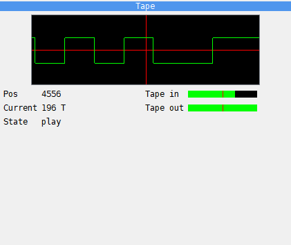

The **Tape** panel draws the tape signal around the place the tape is at. The red
vertical line is the current position: on its left is the signal that has played, on its
right what comes next. The picture covers about two milliseconds of tape at the machine's speed. In the
picture Exolon is loading, with fast loading off.

| Field | What it shows |
|---|---|
| **Pos** | the number of the pulse in the current block; `--` while the tape is stopped |
| **Current** | how much of the current pulse is left; empty while the tape is stopped |
| **State** | **play**, **rec** or **stop** |
| **Tape in** | the level the tape plays into the machine's EAR input |
| **Tape out** | the bit the machine sends to the tape: the bar is full while it is 1 |

Use it while you step through a loader, to see which pulse it is reading and what comes
next. The tape itself is controlled from the **Tape Player** (see [Tapes](tapes.md)).

## FDC

```{index} FDC panel, floppy disk controller
```

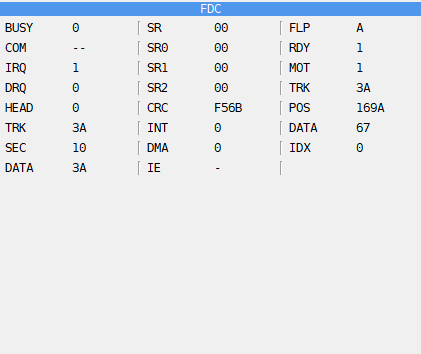

The **FDC** panel shows the floppy disk controller in its left and middle columns and the
drive it works with in the right one. It is there only on a machine with a disk interface
(see [Disks and drives](disks.md)). All numbers are hex; a flag is 1 or 0. In the picture
Fire 'n Ice (n-Discovery, 2003) is loading from a TR-DOS disk: the controller reads a
sector, command 80.

| Field | What it shows |
|---|---|
| **BUSY** | 1 while the controller carries out a command |
| **COM** | the command it carries out; `--` when it is idle |
| **IRQ** | the controller's interrupt request: the command has ended |
| **DRQ** | the data request: a byte is waiting to be read or written |
| **HEAD** | the side of the disk, 0 or 1 |
| **TRK**, **SEC**, **DATA** | the track, sector and data registers |
| **SR** | the status register |
| **SR0**, **SR1**, **SR2** | the result registers of the +3's controller |
| **CRC** | the checksum the controller has worked out so far |
| **INT** | an interrupt waiting on the +3's controller |
| **DMA** | the DMA mode of the +3's controller |
| **IE** | 1 when interrupts from the disk interface are enabled |

| Field | What it shows |
|---|---|
| **FLP** | the drive the controller works with, **A** to **D** |
| **RDY** | a disk is in the drive |
| **MOT** | the drive motor is on |
| **TRK** | the track the head stands on |
| **POS** | the place on the track under the head, in bytes from its start |
| **DATA** | the byte under the head; `--` with no disk |
| **IDX** | the index hole is passing: the start of the track |

Use it to follow a disk loader: step over the OUT that gives a command, then watch
**BUSY**, **DRQ** and the registers as the command runs.

## FDD

```{index} FDD panel, track; raw bytes
```

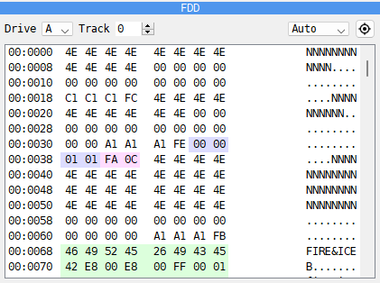

The **FDD** panel shows a whole track of a floppy disk as it lies on the disk: the
gaps, the sector headers, the data and the checksums, byte by byte. It is on a tab beside
**DUMP**, and only on a machine with a disk interface.

- **Drive** - the drive, **A** to **D**.
- **Track** - the track to show, counted with both sides: 0 is the first track on side 0,
  1 the same track on side 1, 2 the next track on side 0, and so on. On a single-sided
  drive the number steps by 2.
- **Bytes per row** - **Auto**, **8/row**, **12/row** or **16/row**.
- {icon}`target` The target button - jumps to the drive, the track and the byte the head is
  at now.

Each row starts with the track and the place on the track, in hex: `02:0040`. The byte
under the head is in bold. Sector headers are in the **ID / Label** color of the
**Debugger** page of **Options**, sector data in the **Data** color and the checksums in
the **CRC** color. With no disk in the drive every byte reads `FF`. The panel cannot be
edited; to change a disk's files, use the **Disk Manager** (see
[Disks and drives](disks.md)).

Use it to see how a disk is laid out: how many sectors a track has, how long they are, and
whether a protected disk has a header or a checksum that is wrong on purpose.

## CMOS

```{index} CMOS panel, clock chip
```

```{index} see: RTC; clock chip
```

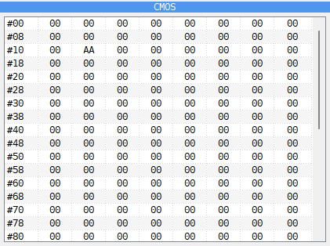

The **CMOS** panel shows the 256 bytes of the clock chip's memory, eight to a row. The
number at the start of a row is the address of its first byte. It is on a tab beside
**DUMP**, and only on a machine that has a clock chip:

- **ZX Evolution (BaseConf)** and **ZX Evolution (TSConf)**;
- **Pentagon 1024 SL**;
- **Profi v5**;
- any machine with the **SMUC** hard disk interface, such as the
  **Scorpion ZS 256 Turbo+**.

Double-click a byte and type a new value in hex to change it.

The time and date in bytes 00 to 09 are not kept here. When the machine reads them, it
gets the time of your computer's clock, so the panel shows only what a program wrote
there. The settings a BIOS keeps in the clock chip are in the bytes from 0E on.

Use it to see which settings a BIOS has stored, or to change one by hand.

## Palette

```{index} Palette panel, palette
```

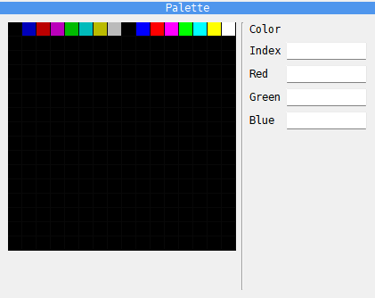

The **Palette** panel shows the machine's palette as it is now: 256 squares, 16 to a row.
Click a square to see its **Index** (0 to 255), its **Red**, **Green** and **Blue** levels
(0 to 255 each) and the **Color** itself. The panel only shows the colors; it cannot
change them.

A plain ZX uses the first 16 squares. With ULA+ in use, the first 64 are the colors the
program set. The ATM Turbo 2+ and the Profi v5 set their colors through ports, and the
colors a program sets show here as it sets them.

On a ZX Evolution this panel is not there: the **Palette** tab of the **ZX Evo** panel
shows the colors instead (see [The Palette tab](#the-palette-tab)).

Use it to check the colors a program has set, for example after a fade to black.

## ZX Evo

```{index} ZX Evo panel, ZX Evolution; Debugger panel, TSConf; Debugger panel, BaseConf; Debugger panel
```

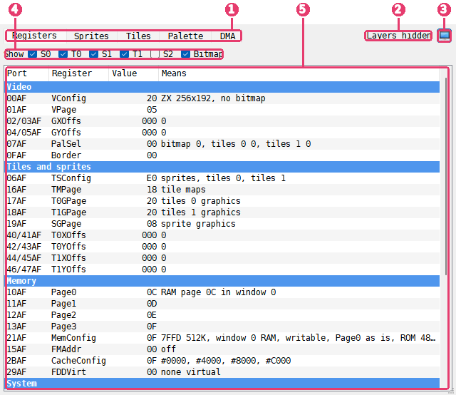

1. **Tabs** - the pages of the panel; which there are depends on the machine.
2. **Layers hidden** - shown while a TSConf layer is kept out of the picture.
3. {icon}`display` **Show in its own window** - moves the panel into the **ZX Evolution**
   window; in this picture the button is pressed in, as the panel is in the window.
4. **Show** - the six layer switches of TSConf.
5. **Register list** - the registers in groups, each with what it means.

The pictures show the panel in its own window, with Uwol: Quest for Money (The Mojon Twins,
TSConf version by Blade and Shiru) on its first level, and layer **S2** switched off.

The **ZX Evo** panel shows what the video and memory hardware of a ZX Evolution is set to.
It is there only on the **ZX Evolution (TSConf)** and **ZX Evolution (BaseConf)** machines,
on a tab beside **Breakpoints**. Its tab shows the NedoPC logo, and its title bar says
**ZX Evo**.

| Machine | Tabs |
|---|---|
| **ZX Evolution (TSConf)** | **Registers**, **Sprites**, **Tiles**, **Palette**, **DMA** |
| **ZX Evolution (BaseConf)** | **Ports**, **Palette** |

In the lists of registers a value that changed since the last step is in the **Changed**
color, as in the **CPU** panel.

Right-click a list of registers, or its header, and choose **In words** or **Field names**.
**In words** says in the last column, **Means**, what a value sets. **Field names** names
the bit fields instead, the way the TSConf and BaseConf documents name them, for example
`VM=ZX RRES=256x192`, and the column is called **Fields**. The choice applies to every list
of the panel and is remembered for the next time.

### The Registers tab

```{index} TSConf; registers
```

The **Registers** tab lists the TSConf registers, the ones a program sets through the
ports that end in AF. They are in five groups: **Video**, **Tiles and sprites**,
**Memory**, **System** and **DMA**.

| Column | What it shows |
|---|---|
| **Port** | the port the register is written through, such as `00AF` |
| **Register** | the name of the register, such as **VConfig** |
| **Value** | the value, in hex |
| **Means** | what the value sets |

Some registers, such as **VConfig**, **VPage**, **PalSel** and **GXOffs**, take a new
value only at the start of the next line. While a new value waits, **Value** shows the
value in use and the value that comes next, as in `00 > 01`, and **Means** describes the
value that comes next.

**FMAddr** in the **Memory** group gives where the three parts of the FMAPS window start:
CRAM, SFILE and the registers. The dump marks the same bytes: see
[The FMAPS window on TSConf](debugger-memory.md#the-fmaps-window-on-tsconf).

The **DMA** group is the same as at the top of the **DMA** tab: see
[The DMA tab](#the-dma-tab).

### Hiding layers

```{index} TSConf; layers, layer; hiding, Layers hidden
```

TSConf builds its picture from six layers. The switches in the **Show** row at the top of
the **Registers** tab hide each layer and show it again:

| Switch | Layer |
|---|---|
| **S0** | the sprites under tile layer 0 |
| **T0** | tile layer 0 |
| **S1** | the sprites between the tile layers |
| **T1** | tile layer 1 |
| **S2** | the sprites over both tile layers |
| **Bitmap** | the bitmap screen |

Use them to find which layer draws something on the screen, or to see what a layer covers.

A switch changes only what you see. The program runs exactly as before, with the same
timing and the same memory, whether a layer is hidden or not.

While the machine runs, the change shows from the next line on. While the machine is
stopped in the Debugger, the main window draws the frame again at once with the layers as
they are now set, as far as the machine had drawn it.

To draw the frame again, the machine runs it once more from a snapshot taken at its start.
When that cannot be done, a note under the switches says why: **Shown from the next
frame:** followed by the reason, such as **the tape or a disk command is running** or
**an RZX is playing or recording**. The layers then change when the machine runs again.
These snapshots are taken only after the Debugger or the **ZX Evolution** window has been
open on TSConf once, so at the first stop there may be none yet: the reason is then
**no snapshot of the frame before**.

While any layer is hidden, **Layers hidden** shows at the top of the panel, on every tab.
The layers stay hidden after you close the Debugger, until you tick them again.

### The Sprites tab

```{index} TSConf; sprites, sprite; TSConf
```

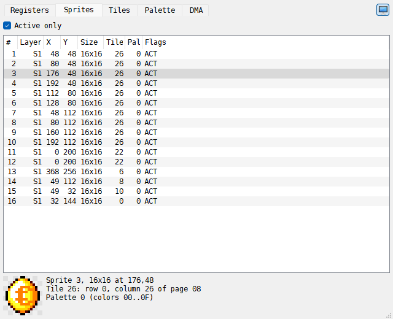

The **Sprites** tab lists the 85 sprites of TSConf, a row each.

| Column | What it shows |
|---|---|
| **#** | the number of the sprite, 0 to 84 |
| **Layer** | the layer it is on: **S0**, **S1** or **S2**; `-` after the third layer has ended |
| **X**, **Y** | where it is, in dots |
| **Size** | its width and height in dots, such as `16x16` |
| **Tile** | the number of its tile in the sprite graphics |
| **Pal** | the palette row its colors come from, 0 to 15 |
| **Flags** | `ACT` active; `XF`, `YF` flipped across or down; `LEAP` the next sprite is on the next layer |

A sprite that is not drawn, because it is not active or comes after the third layer, is
grayed. **Active only**, ticked by default, leaves the sprites that are not active out of
the list.

Click a sprite to see it under the list, in the colors it has now and as large as the room
allows. The dots that are transparent show a checker. Beside the sprite are its size and
place, the row and column of its tile in the sprite graphics page, and the colors of its
palette row. Drag the line between the list and the sprite to change how much room each gets.

### The Tiles tab

```{index} TSConf; tiles, tile map
```

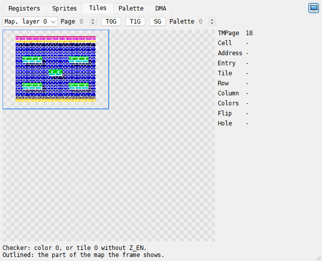

The **Tiles** tab draws a tile map or a page of tile graphics, 512 x 512 dots: 64 x 64
tiles of 8 x 8 dots. Choose what it draws in the list at the top left:

- **Map, layer 0** and **Map, layer 1** - the tile map of a tile layer, drawn with its
  tiles and colors. A box in the **Header** color outlines the part of the map the picture
  shows. Where that part runs past an edge of the map it goes on at the other edge, so the
  box can be in two or four pieces.
- **Graphics** - a page of tile graphics with all its 4096 tiles in order. **Page** is the
  RAM page it starts at, in hex; its arrows step by 8, the length of a graphics page.
  **Palette** is the palette row the tiles are drawn with, 0 to 15. Both are grayed out
  while a map is shown.

**T0G**, **T1G** and **SG** switch to **Graphics** and set **Page** to the page that
**T0GPage**, **T1GPage** or **SGPage** points at.

A checker shows where nothing is drawn: a dot of color 0, which is transparent, and on a
map a cell with tile 0 on a layer that does not draw tile 0.

Move the mouse over the picture to see the cell or the tile under it in the column on the
right. For a map:

| Row | What it shows |
|---|---|
| **TMPage** | the page the tile maps are in |
| **Cell** | the cell, across and down, 0 to 63 |
| **Address** | where the cell's entry is: page and offset, in hex |
| **Entry** | the entry, in hex |
| **Tile** | the tile it holds |
| **Row**, **Column** | where that tile is in the graphics page |
| **Colors** | the 16 colors the cell is drawn with, such as `10..1F` |
| **Flip** | `XF`, `YF`, or `-` when the tile is not flipped |
| **Hole** | **yes** when the cell is not drawn and the layer under it shows through |

For a graphics page the column shows the **Page**, the **Tile** with its **Row** and
**Column**, the **Address** of the tile's first line, and the **Line step**: the bytes from
one line of a tile to the next, in hex.

### The Palette tab

```{index} palette; TSConf, palette; BaseConf
```

On TSConf the **Palette** tab shows the 256 colors of the palette memory, 16 to a row. The
rows are named by their first color, `00` to `F0`, and the columns `0` to `F`. On BaseConf
it shows the 16 palette cells in one row.

The columns **B**, **T0**, **T1** and **S** on the right of the TSConf grid mark the rows
that the bitmap, tile layer 0, tile layer 1 and the sprites take their colors from now.
The color of the border is framed with a dashed line.

Move the mouse over a color to see it in the column beside the grid. Click a color to keep
it there while the mouse is elsewhere; it is framed in white and black.

| Row | What it shows |
|---|---|
| **Index** | the number of the color, in hex |
| **CRAM** | on TSConf, its address in the palette memory |
| **Word** | on TSConf, the word that holds it, in hex |
| **#FF** | on BaseConf, the byte written for this cell through port FF |
| **R**, **G**, **B** | the red, green and blue levels |
| **VDAC_MODE** | on TSConf, the top bit of the word |
| **RGB** | the color as it is shown, in hex |
| **Used by** | the layers whose row it is in, and **border** for the border color |

On TSConf the levels go from 0 to 31. As the note under the grid says, with **VDAC_MODE**
0 a level is at full brightness from 24 on.

### The DMA tab

```{index} TSConf; DMA, DMA
```

The **DMA** tab shows the DMA of TSConf, which copies memory and fills it without the CPU.
At the top are its registers:

| Register | What it shows |
|---|---|
| **DMASAddr**, **DMADAddr** | the source and the destination: page and offset, in hex |
| **DMALen** | the length of a burst, in words |
| **DMANum** | the number of bursts |
| **DMACtrl** | the kind of transfer, such as `RAM > RAM` or `RAM > CRAM`, and its options |
| **DMAStatus** | **running** or **idle** |
| **Source now**, **Dest now**, **Done** | while a transfer runs, how far it has got |

The address registers get their new values only when a transfer ends, so while one runs,
**Source now** and **Dest now** show where it is and **Done** which burst and word it is at.

Under them, **Started this frame and the last** lists each transfer the program started in
the frame the machine is in and in the frame before:

| Column | What it shows |
|---|---|
| **Frame** | **this** or **last** |
| **Line:dot** | where the beam was when it started |
| **Transfer** | the kind of transfer |
| **From**, **To** | the source and the destination: page and offset, in hex |
| **Size** | words per burst x bursts, such as `256 x 4` |
| **Took** | how long it took, in T-states and in lines; **running** while it is not done; **cut short** when the program started the next transfer before it ended |

Use it to see when a program moves its graphics during the frame, and how long it takes.

### The Ports tab

```{index} BaseConf; ports, BaseConf; pager
```

On BaseConf the **Ports** tab shows the ports that set the memory and the screen, in four
groups:

- **Ports** - `7FFD`, `EFF7`, `77` and `BF`, each with what it sets.
- **Windows** - the four 16K windows of the CPU's memory, `#0000` to `#C000`, with the RAM
  or ROM page in each.
- **Pager** - the eight pager registers, two for each window, written through ports
  `0FF7`, `4FF7`, `8FF7` and `CFF7`. One of each pair is used while the ROM signal is off
  (**ROM=0**), the other while it is on (**ROM=1**); a `*` marks the ones in use now.
- **System** - the DOS and NMI state, the CPU clock, the trap address, the border color,
  the virtual drives and ports `2F`, `4F`, `6F` and `8F`.

### The ZX Evolution window

```{index} ZX Evolution window, Show in its own window
```

The button at the top right of the panel, {icon}`display` **Show in its own window**, moves
the panel into a window of its own, **ZX Evolution**. In the window the button is pressed
in; click it again, or close the window, to put the panel back in the Debugger. While the
panel is out, its tab in the Debugger says so, with a **Bring it back** button. Unlike the
**Screen** and **Sound Chips** windows, this one has no command in the **Tools** menu.

The window works without the Debugger: it follows the machine while the machine runs, once
a frame (in fast mode, once in ten frames), and its layer switches work as in the panel.
The window keeps its place and size, and a window that was open when you quit opens again at the next
start. On a machine that is not a ZX Evolution it shows **Nothing to show on this
machine**.

## ZX Next

```{index} ZX Next panel, ZX Spectrum Next; Debugger panel, ZX Next window
```

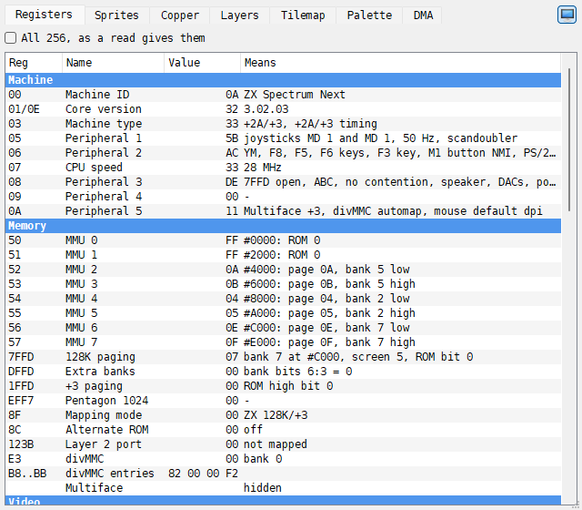

The **ZX Next** panel shows what the hardware of the ZX Spectrum Next is set to. It is
there only on the **ZX Spectrum Next**, on a tab beside **Breakpoints**, and has seven
tabs: **Registers**, **Sprites**, **Copper**, **Layers**, **Tilemap**, **Palette** and
**DMA**. A value that changed since the last step is in the **Changed** color.

Like the ZX Evo panel, it moves into a window of its own, **ZX Next**, with
{icon}`display` **Show in its own window**, and the window follows the machine while it
runs (see [The ZX Evolution window](#the-zx-evolution-window)).

### Registers

The **Registers** tab lists the Next's registers in groups: **Machine**, **Memory**,
**Video**, **Clip and scroll**, **Interrupts**, **Copper**, **Sound** and **UART**.

| Column | What it shows |
|---|---|
| **Reg** | the number of the Next register, or the port, such as `7FFD` |
| **Name** | its name, such as **CPU speed** or **MMU 0** |
| **Value** | the value, in hex |
| **Means** | what the value sets, such as `28 MHz` or `page 0A, bank 5 low` |

Besides the Next registers, the list has the ports and the state behind them: the 128K,
+3 and Pentagon paging ports, the layer 2 port, the divMMC and the Multiface, the four
CTC channels, the AY select and the DACs, and the speed of each UART. Tick **All 256, as
a read gives them** to see every Next register, by number, as a program reads it.

### Sprites

The **Sprites** tab lists the 128 sprites. **Visible only**, ticked by default, leaves out
the ones that are not shown, and those that are listed but not drawn are grayed.

| Column | What it shows |
|---|---|
| **#** | the number of the sprite |
| **X**, **Y** | where it is |
| **Pattern** | its pattern; `a` or `b` after the number for the halves of a 4-bit pattern |
| **Pal** | its palette offset |
| **Scale** | `1x1` to `8x8` |
| **Flags** | `4-bit`; `XM`, `YM` mirrored; `ROT` rotated |
| **Anchor** | the anchor a relative sprite belongs to, unified or composite |

Click a sprite to see it under the list, as large as the room allows, with what it is,
where and in which colors.

### Copper

The **Copper** tab shows the copper's 1024 instructions: **Addr**, **Word** and
**Instruction** (`WAIT`, `MOVE`, `NOOP`, `HALT`). The line at the top says how the copper
runs, where its PC is and where a program's writes go. The row at the PC is lit; with
**Follow PC** ticked the list follows it.

### Layers

The **Layers** tab draws one picture from memory, as it is, with no scroll: layer 2 from
its active or its shadow bank, the ULA screen in bank 5 or 7, the LoRes screen, or the
sprite patterns, 8-bit or 4-bit. The column on the right says what the layer is set to;
move the mouse over the picture for the dot, its address and its color. A checker shows
the transparent color. In the sprite patterns, the ones used by visible sprites are
outlined.

### Tilemap

The **Tilemap** tab draws the whole tile map, with no scroll (**Map**), or the tile
definitions (**Tiles**) in the colors of **Palette offset**. Move the mouse over it to
see the cell, its address, tile, attribute, colors and flips.

### Palette

The **Palette** tab shows one of the eight palettes, 256 colors in a 16 by 16 grid: first
and second for the ULA, layer 2, the sprites and the tilemap. **(in use)** marks the ones
the layers use now. The index that register 40 points at, where register 43 writes, is
framed with a dashed line. Move the mouse over a color, or click it, to see its index,
value, red, green and blue levels, RGB, layer 2 priority and the layers that use it.

### DMA

The **DMA** tab shows the DMA: under **Set up**, the port it was written through (Z80 DMA
or zxnDMA), the direction, ports A and B, the length, the mode and the prescaler; under
**State**, whether it runs and holds the bus, its status, the source, destination and
counter now, and whether a register is half written.

## Screen and Sound Chips windows

```{index} Screen window, Sound Chips window, Show in its own window
```

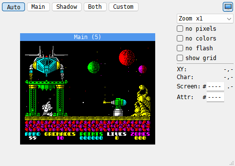

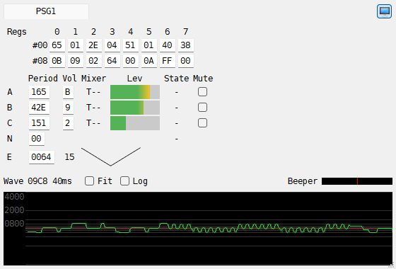

**Tools > Screen** and **Tools > Sound Chips** move the **Screen** and **Sound Chip**
panels out of the Debugger into windows of their own. The same command again puts the
panel back. In the Classic preset the keys are Alt+S and Alt+A; the Modern preset has no
keys for them.

The button at the top right of each panel, {icon}`display` **Show in its own window**, does
the same. In the window it is pressed in; click it again, or close the window, to put the
panel back in the Debugger. While the panel is out, its tab in the Debugger says so, with a
**Bring it back** or **Bring them back** button.

The windows work without the Debugger: they follow the machine while the machine runs, one
picture a frame (in fast mode, one in ten frames). The settings are the same as in the
panel. Each window keeps its place and size, and a window that was open when you quit
opens again at the next start.

## Examples

### See which screen a 128K program draws to

A 128K has two screens, in RAM pages 5 and 7. Many programs draw on the screen that is not
shown and then flip, so that the picture never shows half drawn.

1. Choose a 128K machine and load the program.
2. Choose **Tools > Screen**. The **Screen** window opens.
3. Click **Both**. The window shows **Main (5)** and **Shadow (7)** together.
4. Let the program run. The name of the screen the machine shows is in the **Header**
   color; when the program flips, the other name takes that color.

You see the hidden screen being drawn while the other one is shown. Click **Auto** to see
only the screen the machine shows, the way the main window does.


### Find the bytes behind a spot on the screen

1. Open the Debugger and click the **Screen** tab.
2. Move the mouse onto the spot and click: the cell is marked and the readout stays on it.
3. Read **Screen:** for the byte of pixels and **Attr:** for its colors, for example
   `#4000` and `#5800` for the top left corner.
4. Right-click the picture and choose **Copy screen address**.

With the address in hand, look at the byte in the **DUMP** panel (see
[Memory](debugger-memory.md)), or set a **Write** breakpoint on it to stop the machine
when the program draws there (see [Breakpoints and watching](debugger-breakpoints.md)).

### Watch the AY registers while music plays

1. Choose **ZX Spectrum 128K** and pick **128 BASIC** in its menu.
2. Choose **Tools > Sound Chips**. The **Sound Chips** window opens on **PSG1**.
3. Type `PLAY "cdefgab"` and press Enter.
4. Watch channel A: its **Period** changes with each note, its **Mixer** starts with `T`
   for the tone, and its **Lev** bar rises and falls. The wave box shows the square wave
   of the tone.
5. Tick **Mute** on the A row and play again: the registers still change with each note,
   but you hear nothing.

Untick **Mute** to hear the channel again.
