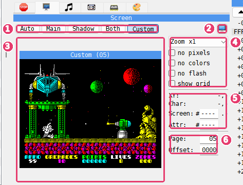
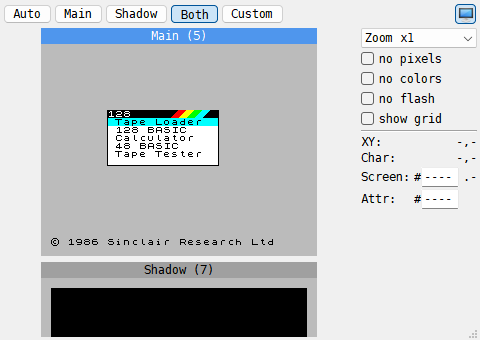

# Screen panel

```{index} Screen panel
```



1. **Mode** - **Auto**, **Main**, **Shadow**, **Both** or **Custom**: which screen is
   drawn.
2. {icon}`display` **Show in its own window** - moves the panel into the **Screen** window.
3. **Picture** - the screen, with a strip of the border color around it and its name
   above it.
4. **View** - the zoom and four check boxes that change how the picture is drawn.
5. **Readout** - where the dot under the mouse is and which bytes hold it.
6. **Page** and **Offset** - only in **Custom** mode: which memory to draw.

The panel draws a ZX screen of 256 x 192 dots from memory: 6144 bytes of pixels and 768
bytes of attributes, in the standard layout. It draws that layout whatever video mode the
machine is in, so it always shows what a ZX screen at that place in memory would look
like.

## Which screen

```{index} shadow screen, Screen panel; which screen
```

| Button | What it draws |
|---|---|
| **Auto** | the screen the machine is showing now; it follows a program that flips between two screens |
| **Main** | the normal screen, RAM page 5 |
| **Shadow** | the second screen of a 128K, RAM page 7 |
| **Both** | page 5 and page 7 side by side, or one above the other in a tall panel |
| **Custom** | any 16K page, from any offset in it |

**Shadow** and **Both** are grayed out on a machine with no page 7, such as the 48K.

The name above a picture says where it comes from: **Main (5)**, **Shadow (7)**, or
**Page** with a number for any other page. In **Custom** mode it is **Custom** with the
page number. The name of the screen the machine is showing is in the **Header** color of
the **Debugger** page of **Options**; the other one is plain.

In **Custom** mode, type the page into **Page** and the place in the page where the screen
starts into **Offset**, both in hex. **Offset** goes from 0000 to 3FFF. Use **Custom** to
look at a picture a program keeps elsewhere in memory, for example one it copies to the
screen later.

## How it is drawn

```{index} Screen panel; zoom
```

| Setting | What it does |
|---|---|
| **Zoom Fit** | fills the panel; when there is room, each dot takes a whole number of pixels |
| **Zoom x1** to **Zoom x4** | a fixed number of pixels per dot |
| **no pixels** | attributes only: each cell is its paper color with a small dot of ink in the middle |
| **no colors** | pixels only, white on black |
| **no flash** | holds flashing cells still; grayed out while ULA+ is in use |
| **show grid** | dims every other 8 x 8 cell, so the character cells can be counted |

## Finding a dot

```{index} screen address, attribute address, Copy screen address, Copy attribute address
```

Move the mouse over the picture. The readout shows:

| Field | What it shows |
|---|---|
| **XY:** | the dot, in pixels from the top left corner: 0 to 255 across, 0 to 191 down |
| **Char:** | the character cell, 0 to 31 across, 0 to 23 down |
| **Screen:** | the address of the byte that holds the dot, and after it the bit: `.7` is the leftmost dot of the byte |
| **Attr:** | the address of the attribute byte that colors the dot's cell |

The addresses are the ones the CPU uses. The addresses of page 5 start at 4000, where this
page always is in memory. The addresses of any other page start at C000, where a 128K pages
it in.

Click the picture to hold the readout on a dot: the cell is marked, and the numbers stay
while you move the mouse away. Click again to let go.

Right-click the picture for **Copy screen address** and **Copy attribute address**. They
copy the address of the dot under the mouse, or of the held dot, as four hex digits.

The readout works the other way too: type an address into **Screen:** or **Attr:** and the
cell it belongs to is marked on the picture. Move the mouse back over the picture to make the
readout follow the mouse again.

## Examples

### See which screen a 128K program draws to

A 128K has two screens, in RAM pages 5 and 7. Many programs draw on the screen that is not
shown and then flip, so that the picture never shows half drawn.

1. Choose a 128K machine and load the program.
2. Choose **Tools > Screen**. The **Screen** window opens.
3. Click **Both**. The window shows **Main (5)** and **Shadow (7)** together.
4. Let the program run. The name of the screen the machine shows is in the **Header**
   color; when the program flips, the other name takes that color.

You see the hidden screen being drawn while the other one is shown. Click **Auto** to see
only the screen the machine shows, the way the main window does.



### Find the bytes behind a spot on the screen

1. Open the Debugger and click the **Screen** tab.
2. Move the mouse onto the spot and click: the cell is marked and the readout stays on it.
3. Read **Screen:** for the byte of pixels and **Attr:** for its colors, for example
   `#4000` and `#5800` for the top left corner.
4. Right-click the picture and choose **Copy screen address**.

With the address in hand, look at the byte in the **DUMP** panel (see
[DUMP panel](debugger-memory.md)), or set a **Write** breakpoint on it to stop the machine
when the program draws there (see [Breakpoints panel](debugger-breakpoints.md)).
