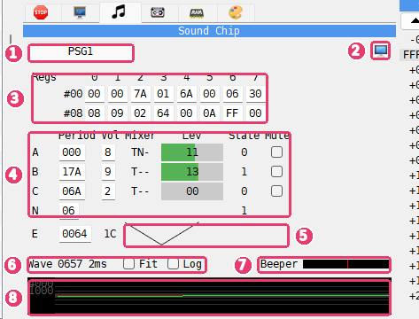

# Sound Chip panel

```{index} Sound Chip panel
```



1. **Chips** - a tab for each sound chip of the machine.
2. {icon}`display` **Show in its own window** - moves the panel into the **Sound Chips**
   window.
3. **Regs** - the 16 registers of the chip.
4. **Channels** - the tone channels A, B and C, the noise N and the envelope E.
5. **Envelope** - the shape of the envelope.
6. **Wave** - the peak level, the time span, and the **Fit** and **Log** check boxes.
7. **Beeper** - the level of the beeper.
8. **Wave box** - the sound the machine puts out.

In the picture the title tune of Cybernoid (Dave Rogers, Hewson, 1988) plays.

The tabs are named **PSG1**, **PSG2** and so on, one for each AY or YM chip: a TurboSound
machine has two. A chip with an FM part, as in TurboSound FM, has an **FM** tab beside its
**PSG** tab. A machine with no sound chip has no tabs.

## The PSG page

```{index} AY; registers, Sound Chip panel; Mute
```

**Regs** shows the 16 registers in two rows: `#00` holds registers 0 to 7, `#08` holds
registers 8 to 15. Click a register and type a new value in hex. The value goes to the chip
as if a program wrote it with an OUT to the chip's port, so the rest of the page changes
with it.

The table below it shows the same registers by channel:

| Column | What it shows |
|---|---|
| **Period** | the tone period of A, B and C (up to FFF), the noise period of N (up to 1F), the envelope period of E (up to FFFF) |
| **Vol** | the volume of A, B and C, 0 to F; on the E row, the level the envelope is at now |
| **Mixer** | what the channel mixes: `T` tone, `N` noise, `E` the envelope in place of the volume; `-` for off |
| **Lev** | how loud the channel is, as a bar |
| **State** | the output of the tone or noise generator, 0 or 1 |
| **Mute** | tick to silence the channel |

**Period** and **Vol** can be changed as the registers can: click and type in hex.

**Lev** is green, amber near the top and red at the end. While the machine runs, the bar
shows the loudest level of the channel since the last refresh. While the machine stands
still, the bar
and the number on it show exactly what the channel puts out at that moment.

**State** is shown only while the machine stands still. A tone generator flips much too
fast to be read while the machine runs, so the column shows `-` then.

**Mute** silences a channel without touching the chip: the program goes on writing the
same registers, and the other channels play as before. Use it to pick one voice out of a
tune.

The E row draws the envelope shape set in register 13: two cycles of it, so the eight
shapes can be told apart.

## The FM page

```{index} FM; registers, YM2203
```


The FM page shows the FM part of a YM2203 chip. Across the top:

| Field | What it shows |
|---|---|
| **Timer A**, **Timer B** | the timer values in hex, and **on** or **off** |
| **Ch3** | the mode of channel 3: **off**, **special** or **CSM** |
| **1**, **2**, **3** | tabs for the three FM channels |
| **off** | tick to silence this FM channel |
| **Alg**, **Fb** | the algorithm and the feedback of the channel |
| **Bk/Fq** | the block and frequency of the channel |
| **Out** | the channel's output now |

Under them is a row for each operator, **Op1** to **Op4**. **DT**, **MUL**, **TL**,
**RS**, **AR**, **DR**, **SL**, **SR**, **RR** and **EG** are the operator's register
fields: click one and type a new value in hex. **St** is the state of the operator's
envelope (**OFF**, **ATK**, **DEC**, **SUS** or **REL**), **Bk/Fq** its block and
frequency, and **Lev** its envelope level, where a bigger number is louder. A `*` in the
last column marks the operators that reach the output in the channel's algorithm.

## Wave and Beeper

```{index} wave box, beeper; level
```

The wave box at the bottom shows the sound the machine puts out, all sources mixed: the
sound chips, the beeper and the rest. While the machine runs it holds the last 40
milliseconds, enough to see a tune move. While the machine stands still it holds the last
2 milliseconds, fine enough to count the edges of a beeper routine one step at a time.

The number beside **Wave** is the highest level in the box, in hex, followed by the time
the box holds. The scale at the left marks the levels.

- **Fit** - centers the wave and scales the box to it, so quiet sound fills the box too.
  With **Fit** off, the box keeps one fixed scale.
- **Log** - draws the wave on a curve, so a quiet tune is still visible beside a loud one.

**Beeper** is a bar of the beeper's level.

## Example

### Watch the AY registers while music plays

1. Choose **ZX Spectrum 128K** and pick **128 BASIC** in its menu.
2. Choose **Tools > Sound Chips**. The **Sound Chips** window opens on **PSG1**.
3. Type `PLAY "cdefgab"` and press Enter.
4. Watch channel A: its **Period** changes with each note, its **Mixer** starts with `T`
   for the tone, and its **Lev** bar rises and falls. The wave box shows the square wave
   of the tone.
5. Tick **Mute** on the A row and play again: the registers still change with each note,
   but you hear nothing.

Untick **Mute** to hear the channel again.
