# The Debugger

```{index} Debugger
```

The Debugger stops the machine and shows what is inside it: the program as Z80 code, the
CPU registers, the memory, the stack and the state of the devices. From there you run the
program one instruction at a time, change registers and memory, and set breakpoints that
stop the machine where you want it.

This chapter is about the window, running and stepping, the CPU registers and the small
state panels. The rest has chapters of its own: [Code and labels](debugger-code.md),
[Memory](debugger-memory.md), [Breakpoints and watching](debugger-breakpoints.md) and
[Device panels](debugger-devices.md).

## The window

```{index} Debugger; window
```

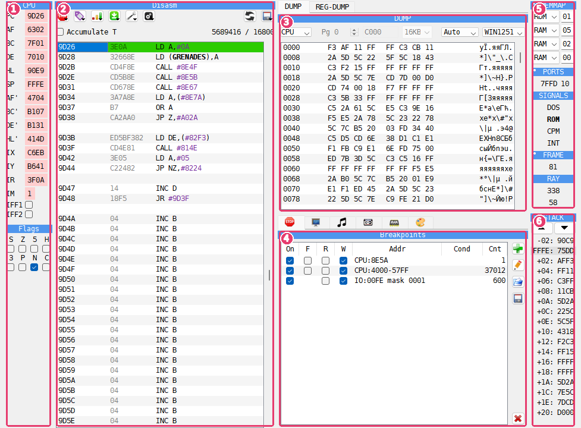

1. **CPU** - the registers and flags. See [The CPU panel](#the-cpu-panel).
2. **Disasm** - the program as code, with the Debugger's buttons and the T-state counter
   above it. See [Code and labels](debugger-code.md).
3. **DUMP** - memory as bytes, with **REG-DUMP**, **FDD** and **CMOS** on tabs behind it.
4. **Breakpoints** - the list of breakpoints, with **Screen**, **Sound Chip**, **Tape**,
   **FDC**, **Heat map** and **Palette** on tabs behind it. On a ZX Evolution, **ZX Evo**
   is there in place of **Palette**.
5. **MEMMAP** - the memory banks, the watched ports and the state of the machine. See
   [The MEMMAP panel](#the-memmap-panel).
6. **STACK** - the words on the stack. See [The STACK panel](#the-stack-panel).

Most pictures of the Debugger chapters show it stopped in a game, Exolon (Raffaele Cecco,
Hewson, 1987), with three labels and three breakpoints set for it.

The window title is **Xpeccy+ Debugger**. The Debugger keeps its own position and size,
and its own font, set on the **Debugger** page of **Options**.

## Opening and closing

```{index} Debugger; opening and closing
```

Open the Debugger in any of these ways:

- **Debug > Debugger**, or the {icon}`bug` **Debug** button on the toolbar;
- **Debugger** in the menu that a right-click on the picture opens;
- the **Debugger** hotkey: F10 (Modern), Esc (Classic);
- `-d` on the command line opens it as soon as the program starts (see
  [Command line](command-line.md#debugging));
- a breakpoint opens it by itself when the machine reaches it (see
  [Breakpoints and watching](debugger-breakpoints.md)).

While the Debugger is open, the machine stands still. There is no sound, fast mode is
switched off, and keys pressed in the main window do not reach the machine. The picture in
the main window shows the frame as far as the machine had drawn it; the part not drawn yet
shows the previous frame, darkened. A click on the main window brings the Debugger back to
the front.

To let the machine run on, close the Debugger: press Esc, press the **Debugger** hotkey
again, or close the window. The machine goes on from the instruction the Debugger shows.
That instruction runs first even if a breakpoint is on it, so the machine does not stop on
the same place again at once.

## The panels

```{index} panel
```

Every part of the window is a panel that can be moved. Panels that share a place are
tabs: click a tab to bring its panel to the front. Some tabs show only an icon; the name of
the panel in front is in its title bar.

| Panel | What it shows | Explained in |
|---|---|---|
| **CPU** | the CPU registers and flags | [The CPU panel](#the-cpu-panel) |
| **Disasm** | the program as code | [Code and labels](debugger-code.md) |
| **DUMP** | memory as bytes and text | [Memory](debugger-memory.md) |
| **REG-DUMP** | the memory the registers point at | [Memory](debugger-memory.md) |
| **CMOS** | the clock chip's memory | [Device panels](debugger-devices.md#cmos) |
| **Heat map** | how often each memory cell is read, written and run | [Memory](debugger-memory.md) |
| **Breakpoints** | the breakpoints | [Breakpoints and watching](debugger-breakpoints.md) |
| **Screen** | a ZX screen drawn from memory | [Device panels](debugger-devices.md) |
| **Sound Chip** | the registers of the sound chips | [Device panels](debugger-devices.md) |
| **Tape** | the tape's state and the signals in and out | [Device panels](debugger-devices.md) |
| **FDC** | the floppy disk controller and the drive | [Device panels](debugger-devices.md) |
| **FDD** | the bytes on a track of a floppy disk | [Device panels](debugger-devices.md) |
| **Palette** | the colors of the machine's palette | [Device panels](debugger-devices.md) |
| **ZX Evo** | the video and memory hardware of a ZX Evolution | [Device panels](debugger-devices.md#zx-evo) |
| **MEMMAP** | the memory banks, ports and signals | [The MEMMAP panel](#the-memmap-panel) |
| **STACK** | the words on the stack | [The STACK panel](#the-stack-panel) |

**CMOS** is there only on machines that have a clock chip: the ZX Evolution with BaseConf
or TSConf, the Pentagon 1024, the Profi v5, and any machine with a SMUC. **FDC** and **FDD**
are there only on a machine with a disk interface. **ZX Evo** is there only on a ZX
Evolution, with TSConf or BaseConf, and **Palette** on every other machine.

**Screen** and **Sound Chip** can also be windows of their own: **Debug > Screen** and
**Debug > Sound Chips** open them, and they work while the machine runs. **ZX Evo** can be
one too, from the {icon}`display` button at the top right of the panel. See
[Device panels](debugger-devices.md).

### Arranging the panels

```{index} panel; arranging, Reset panel layout
```

Drag a panel by its title bar and drop it where you want it: beside another panel, above
or below it, or onto it to put the two panels on tabs. Drop it at the far left or far right
edge of the window to give it a column of its own. Drag the line between two panels to
share the room differently.

A panel cannot be closed, and it cannot leave the window.

The arrangement is kept: the next time the Debugger opens, and the next time the program
starts. To get the arrangement it ships with, choose **Reset panel layout** from the
{icon}`settings` **Options** button over the listing. This command also brings the window
back to its original size.

## The buttons over the listing

A row of buttons above the **Disasm** panel holds the Debugger's menus. Hold the mouse over
a button to see its name. The menus that belong to the listing are described in full in
[The toolbar](debugger-code.md#the-toolbar).

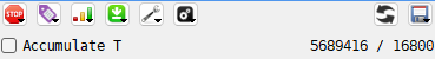

| Button | What is in it |
|---|---|
| {icon}`stop` **Breakpoints** | **Fetch break**, **Read break**, **Write break** on the line or block - see [Breakpoints and watching](debugger-breakpoints.md) |
| {icon}`label` **Labels** | show, load, save and list labels - see [Code and labels](debugger-code.md) |
| {icon}`bars` **View** | show the lines as **Opcode**, **Byte**, **ASCII**, **Word** or **Address** - see [Code and labels](debugger-code.md) |
| {icon}`arrGreen` **Trace** | the kinds of trace - see [Trace](#trace) |
| {icon}`other` **Tools** | **Search**, **Fill...**, **Sprite scanner** ([Memory](debugger-memory.md)), **Keyboard** (the [Virtual Keyboard](input.md#virtual-keyboard)), **Watcher** ([Breakpoints and watching](debugger-breakpoints.md)) |
| {icon}`settings` **Options** | how the listing looks, writing to ROM, runtime mapping ([Code and labels](debugger-code.md)), and **Reset panel layout** |
| {icon}`refresh` **Reload snapshot & labels** | opens the last file again and its labels, as **File > Reload** does |
| {icon}`floppy` (disk) | **Disasm to file**, **Load dump**, **Save dump**, **Load map**, **Save map** - see [Code and labels](debugger-code.md) and [Memory](debugger-memory.md) |

## Running and stepping

```{index} step, step; keys, Fast step
```

These keys work while the Debugger has the focus. The **Hotkeys** page of **Options** lists
them under **Debugger**, and changes them there (see [Hotkeys](hotkeys.md)).

| Action | Modern | Classic | What it does |
|---|---|---|---|
| Step in | F7 | F7 | runs one instruction |
| Step over | F8 | F8 | runs one instruction; a call or a loop runs to its end |
| Step out | Shift+F8 | F6 | runs until the current subroutine returns |
| Fast step | Alt+F7 | Alt+F7 | runs ten instructions |
| Stop here | F4 | F9 | runs until the line under the cursor |
| Trace | Ctrl+T | Ctrl+T | runs instruction by instruction until you press a key |
| Close | Esc | Esc | closes the Debugger and lets the machine run |

After each step every panel shows the new state, and the registers that changed are
marked.

```{index} Step in, Step over, Step out, Stop here
```

**Step in** runs the instruction at PC, the line marked in the listing. Hold the key down
to keep stepping: the Debugger traces, as with **Trace**, until you release the key.

**Step over** runs some instructions to their end in one step: CALL, RST, DJNZ, HALT and
the repeating block instructions LDIR, LDDR, CPIR, CPDR, INIR, INDR, OTIR and OTDR. The
Debugger closes, the machine runs at full speed until it reaches the instruction that
follows in memory, and the Debugger opens again there. Any other instruction is one step,
as with **Step in**.

**Step out** lets the machine run until the subroutine it is in returns. Calls and
interrupts made on the way are counted, so only the RET that ends this subroutine stops
the machine. The Debugger opens after that RET.

**Stop here** runs the machine at full speed until PC reaches the line the cursor is on
in the listing. Click the line first, so the listing has the focus.

**Step over**, **Step out** and **Stop here** let the machine run with the Debugger
closed. If a breakpoint stops the machine first, or you open the Debugger yourself, the
place where the machine was to stop is forgotten. If the program never gets there, the
machine just runs on.

While you step or trace, breakpoints are not checked. They work again once the machine
runs with the Debugger closed.

### Trace

```{index} trace, Trace and stop here, Trace and stop on INT, Trace log
```

Trace runs the program one instruction after another, and the panels show each step as it
happens. Press any key to stop it. Trace is much slower than the machine at full speed.

The {icon}`arrGreen` **Trace** button over the listing holds four kinds of trace:

- **Trace** - until you press a key;
- **Trace and stop here** - until PC reaches the line the cursor is on. It is also in the
  menu that a right-click on the listing opens;
- **Trace and stop on INT** - until an interrupt comes that the CPU will take;
- **Trace log** - asks for a file name, then traces until you press a key and writes one
  line per instruction into the file.

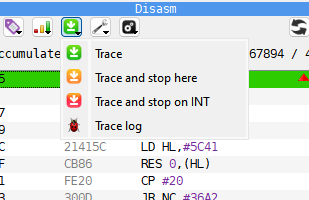

```{index} trace; log format
```

The first line of a trace log names the columns. On a Z80 it reads:

```
addr|command|PC|AF|BC|DE|HL|SP|AF'|BC'|DE'|HL'|IX|IY|IR|IM|IFF1|IFF2
```

Each following line is one instruction: its address, the instruction itself, and the
registers after it ran, in hex. The columns are separated by `|`, and the numbers are in
quotes so that a spreadsheet keeps them as text: open the file there with `|` as the
separator.

### The T-state counter

```{index} T-state counter, Accumulate T, T-state; counting
```

Above the listing, on the right, are two numbers:

- the left one is the number of T-states the last step took. After the machine ran with
  the Debugger closed - **Step over**, **Stop here**, a breakpoint - it is the T-states of
  that whole run;
- the right one is the number of T-states since the start of the current frame, that is,
  since the last frame interrupt.

Tick **Accumulate T** to add the steps up: the left number keeps growing from step to step
until you untick it. Ticking it starts the count again from 0.

The count is the real time on the machine, with memory contention and the interrupts that
came in between.

## The CPU panel

```{index} CPU panel, register, flag
```

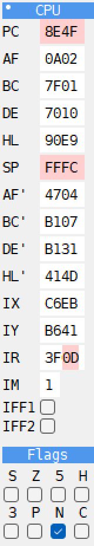

The **CPU** panel shows the Z80 registers: PC, AF, BC, DE, HL, SP, the alternate set AF',
BC', DE', HL', then IX, IY, IR, IM and the interrupt switches IFF1 and IFF2. Under them
are the flags S, Z, 5, H, 3, P, N and C.

A register that changed in the last step is marked in the **Changed** color of the
**Debugger** page of **Options**. With **Split pairs** on, only the byte that changed is
marked: after an instruction that changes only A, only the A half of AF lights up.

### Changing registers

```{index} register; changing
```

Click a value and type over it in hex. The change takes effect at once. In a value field:

- Up and Down, or the mouse wheel, add or subtract 1;
- PgUp and PgDn add or subtract 256;
- X switches the field between hex and decimal.

IFF1 and IFF2 are check boxes. Tick or untick a flag to change it in F.

Click the name of a register to see, in the listing, the code at the address the register
holds.
Right-click the name to see that address in the **DUMP** panel.

### Layouts

```{index} CPU panel; layout, Split pairs
```

Right-click the panel's title bar to choose how the registers are laid out. A small dot in
the corner of a title bar shows that the panel has such a menu.

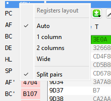

- **Auto** (the default) - one column when the panel is narrow, two when it is wide enough.
  **Auto** also uses two columns when two panels stand side by side under the **CPU**
  panel.
- **1 column** - a register on each line.
- **2 columns** - two on a line, each beside its pair: AF beside AF', PC beside SP.
- **Wide** - a column for each kind: AF, BC, DE, HL; the alternate set; PC, SP, IX, IY; and
  IR, IM, IFF1, IFF2. The flags are one more column beside them, under the title **Flags**.
- **Split pairs** - mark only the byte that changed, as above. On by default.

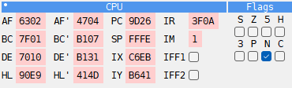

## The STACK panel

```{index} STACK panel, Stack offset
```

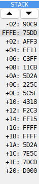

Each line of the **STACK** panel is a word in memory, starting near the address SP holds.
The shaded line is the word at SP, named by its address. The lines above and below it are
named by their distance from SP: `-02:`, `+02:`, `+04:` and so on. The panel shows as
many lines as fit in its height.

The two arrows at the top move the lines by a word. The first line can be from 16 bytes
before SP to 16 bytes after it. Where the panel starts is the **Stack offset** on the **Debugger** page of **Options**:
`-2` by default, so the word just above SP is in view too.

## The MEMMAP panel

```{index} MEMMAP panel, memory bank
```

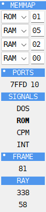

The **MEMMAP** panel holds a few small blocks, one under another. The **Debugger** page of
**Options** sets which of them are shown.

The four rows at the top are the four 16K banks of the Z80's memory, with what is in each:
ROM or RAM and the page number. You can put another page into a bank from here. See
[Memory](debugger-memory.md).

```{index} FMAPS, TSConf; FMAPS
```

On the **ZX Evolution (TSConf)** a fifth row says where the FMAPS window is: `FM #0000`
when port `15AF` (**FMAddr**) has switched it on at `#0000`, `FM off` when it is off. The
window is for writing only: a write in its first `#0500` bytes also goes to the palette
(CRAM, from `+#000`), the sprite descriptors (SFILE, from `+#200`) or the TSConf registers
(from `+#400`, one byte for each port `#xxAF`), and a read gives what is in the bank. The
row and these bytes in the dump are drawn in the **FMAPS** color; the tooltip of a byte
in the dump says where a write to it goes.

**PORTS** lists the watched ports and the last value on each. For a port whose value the
machine keeps in a register, such as `7FFD` on a 128K, the value shown is that register's;
for any other port it is the last byte read from it or written to it, and `--` until the
port is used.

```{index} SIGNALS
```

**SIGNALS** are four words that are bold while the signal is on:

- **DOS** - the TR-DOS ROM is switched in;
- **ROM** - the ROM bit of port `7FFD` is set; on a 128K that is the 48K BASIC ROM;
- **CPM** - the machine is in its CP/M mode;
- **INT** - an interrupt is waiting and the CPU will take it.

```{index} FRAME, frame counter, Reset counter
```

**FRAME** counts the frames since the last reset. Right-click it and choose
**Reset counter** to start it again from 0, for example to count the frames until
something happens. Breakpoint conditions read the same number as `FRAME` (see
[Breakpoints and watching](debugger-breakpoints.md)).

```{index} RAY, beam position
```

**RAY** is where the beam is on the frame: X on the first line, Y on the second. X is bold
during the line's blanking, Y during the frame's.

### Watched ports

```{index} Watched Ports, port; watched
```

Right-click **PORTS**, or any port under it, and choose **Watched ports...** to change the
list.

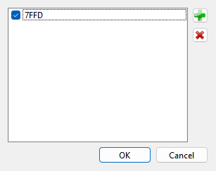

Each line is a port in hex. Four digits are a full address, matched as it is; two digits
are a byte port, matched on the low byte alone. Untick a port to stop showing it while
keeping it in the list. Of the buttons beside the list, {icon}`add` adds a port and
{icon}`cancel` removes the selected one. Double-click a port to change it.

The ports whose values the machine keeps in registers are added to the list automatically;
untick them if you do not need them. The list is kept for the machine that is running. The
**Ports** group of the **Debugger** page of **Options** is the same list.

## The Debugger page of Options

```{index} Debugger page, Debugger; font, Debugger; colors, State info, DB in row, DW in row, Max text length
```

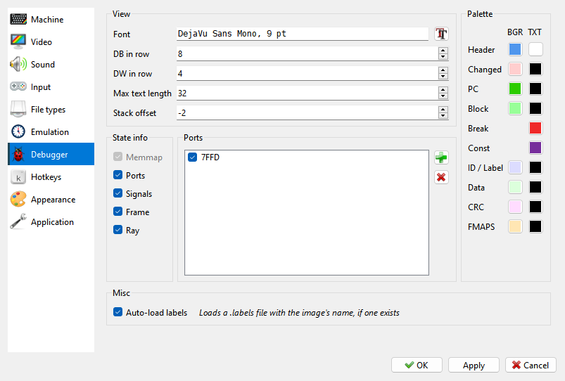

**View**:

- **Font** - the font of all the Debugger's panels. The {icon}`font` button beside it
  picks one. The menus keep the font of the rest of the program.
- **DB in row**, **DW in row**, **Max text length** - how many bytes, words or characters
  one line of the listing holds when it shows data instead of code. See
  [Code and labels](debugger-code.md).
- **Stack offset** - where the **STACK** panel starts, from -16 to 16 bytes from SP. See
  [The STACK panel](#the-stack-panel).

**State info** - which blocks the **MEMMAP** panel shows: **Ports**, **Signals**, **Frame**
and **Ray**. **Memmap** cannot be switched off: the panel's title bar, which you drag the
panel by, is part of it.

**Ports** - the watched ports of the machine that is running. See
[Watched ports](#watched-ports).

**Palette** - the Debugger's own colors, each with a background (**BGR**) and a text
(**TXT**) color. Click a color to change it; right-click it to go back to the color of
the interface style.

| Color | Where it is used |
|---|---|
| **Header** | the title bars of the panels and the block names of **MEMMAP** |
| **Changed** | a value that changed in the last step |
| **PC** | the line of the listing at PC |
| **Block** | a selected block in the listing and the dump |
| **Break** | the lines that have a breakpoint |
| **ID / Label** | the ID field of a disk track, and labels in the listing |
| **Data** | the data of a disk sector |
| **CRC** | the checksums on a disk track |
| **Const** | constants in the listing |
| **FMAPS** | the TSConf FMAPS window in the dump and **MEMMAP** |

Choosing another interface style on the **Appearance** page puts these colors back to that
style's own.

**Misc** - **Auto-load labels**: opening an image also loads a `.labels` file of the same
name, if there is one. See [Code and labels](debugger-code.md).

## Examples

### Stop at the start of a loaded program and step through it

```{index} breakpoint; at the start of a program
```

A program on tape usually loads a code block and starts it at its first byte. The
**Info** column of the **Tape Player** shows where a code block loads, for example
`CODE 32768,6912`: the program starts at 32768, which is `8000` in hex.

1. Mount the tape - do not run it (see [Run a program](getting-started.md#run-a-program)).
2. Open the Debugger. Click the listing, press G, type `8000` and press Enter. The listing
   shows address 8000 (see [Typing an address](debugger-code.md#typing-an-address)).
3. Press Space. The line gets a breakpoint, shown in the **Break** color.
4. Press Esc. The machine runs.
5. Load the tape: `LOAD ""` in 48K BASIC, or **Tape Loader** in the 128K menu.
6. When the loader jumps to the program, the Debugger opens with the first instruction at
   8000 marked as PC. Nothing of the program has run yet.
7. Press F7 to run one instruction at a time and watch the registers change. Press F8 on a
   CALL to run the whole subroutine at once.

The breakpoint stays and stops the machine there again the next time. Press Space on the
line again to remove it.

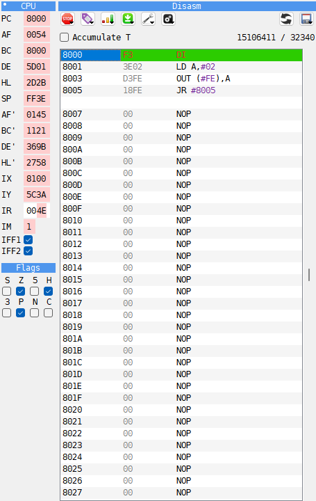

### Count the T-states of a routine

```{index} T-state; timing a routine
```

1. Stop the machine on a CALL of the routine, with a breakpoint or by stepping to it.
2. Make sure **Accumulate T** is not ticked.
3. Press F8 (**Step over**). The routine runs at full speed, and the Debugger opens again
   on the line after the CALL.
4. The left number of the T-state counter is the time the CALL took, the routine and its
   RET included.

To time a part of a routine instead, step to where the part begins, click the line where it
ends and press **Stop here**: F4 (Modern), F9 (Classic).

To add up a few instructions, tick **Accumulate T** - the left number starts from 0 - and
press F7 for each one. The left number is their sum.

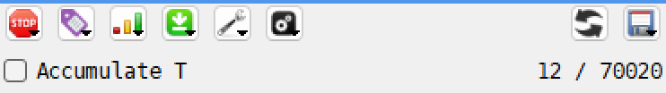
