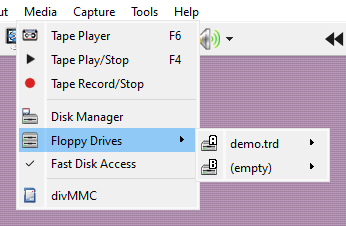
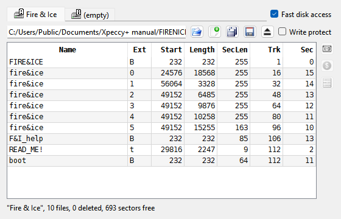
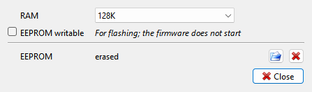

# Disks and drives

```{index} disk
```

A machine can have floppy drives, hard disks, an SD card or a cartridge slot, depending on
the hardware it copies, and a divMMC can be added to the Sinclair models and the Pentagons. The **Media** menu
lists only what the running machine has.

## Which machine has what

```{index} Beta Disk, TR-DOS, +3DOS, disk interface, NemoIDE, SMUC
```

| Machine | Floppy | Hard disk | Other |
|---|---|---|---|
| ZX Spectrum 48K | - | - | cartridge, divMMC |
| ZX Spectrum 128K, +2, +2A | - | - | divMMC |
| ZX Spectrum +3 | +3 drives | - | divMMC |
| Pentagon, Pentagon 1024 SL | Beta Disk | - | divMMC |
| Scorpion ZS 256 | Beta Disk | - | |
| Scorpion ZS 256 Turbo+ | Beta Disk | SMUC | |
| ATM Turbo 2+ | Beta Disk | ATM Turbo | |
| Profi v3 | Beta Disk | - | |
| Profi v5 | Beta Disk | Profi | |
| ZX Evolution, both | Beta Disk | NemoIDE (ZX Evo) | SD card |
| ZXM-Phoenix | Beta Disk | - | |
| ALF TV Game, ALF TV Game 128K | - | - | cartridge |

**Beta Disk** is the TR-DOS disk interface with up to four drives, A to D. The **+3**
interface has two drives, A and B, and runs +3DOS.

A machine with no disk interface of its own can be given one. Open the **Machine** page of
**Options** and pick it in the **Disk** row: **None**, **Beta Disk (WD1793)** or
**+3 (uPD765)**. The **Hard disk** row does the same for an IDE interface: **NemoIDE**,
**NemoIDE A8**, **NemoIDE (ZX Evo)**, **SMUC**, **ATM Turbo** or **Profi**. An interface that
is part of the machine's board cannot be changed: the list is grayed out, and its tooltip
says **Built into this board**. A Beta Disk cannot be added to the +2A and +3.

## Floppy disks

### Putting a disk in

```{index} floppy disk, Floppy Drives, Write Protect
```

```{index} see: floppy; floppy disk
```

Open a disk image with **File > Open...**, or drop it onto the window: it goes into drive A
(see [Run a program](getting-started.md#run-a-program)). To put it into another drive, pick
**Disk B**, **Disk C** or **Disk D** as the file type in the open dialog.



**Media > Floppy Drives** has a submenu for each drive the machine has. The submenu is named
after the disk in the drive, or **(empty)**; the drive letter is on its icon. A star after
the name means the disk has been changed and not saved yet. Each submenu has:

- **Open...** - put a disk image into this drive. It is only mounted: nothing starts, and
  the machine stays the same.
- **New** - put an empty disk into this drive. On a Beta Disk machine you are asked
  **Format for TR-DOS?**: {icon}`ok-apply` **Yes** gives an empty TR-DOS disk ready for
  files, {icon}`cancel` **No** gives an unformatted one, for a program that formats it
  itself.
- **Save** - write the disk back to the file it came from.
- **Save As...** - write the disk to a new file; you pick the name and the format.
- **Eject** - take the disk out.
- **Write Protect** - the machine cannot write to this disk, as with the tab on a real one.

A right-click on a drive's {icon}`diskGreen` light in the status bar opens the same menu.

### Disk formats

```{index} TRD, SCL, UDI, DSK, TD0, FDI, IMA, Hobeta, RAW file to disk
```

| Format | Opens | Saves | What it is |
|---|---|---|---|
| `.trd` | yes | yes | TR-DOS disk, sector by sector |
| `.scl` | yes | yes | TR-DOS files packed together without the empty space |
| `.udi` | yes | yes | the whole disk track by track, as the drive reads it |
| `.dsk` | yes | yes | +3 disk (extended DSK too) |
| `.td0` | yes | - | Teledisk image |
| `.fdi` | yes | - | FDI image |
| `.ima`, `.img` | yes | - | 1.44 MB PC floppy |
| `.$B`, `.$C`... | yes | - | Hobeta: one TR-DOS file |

A **Hobeta** file is not a disk but a single TR-DOS file. Opening it into a drive adds the
file to the disk that is there; an empty drive gets a new TR-DOS disk with the file on it.

Any other file can be opened as **RAW file to disk**: it is copied onto the TR-DOS disk in
the drive as one file, named after the host file. A file longer than 65280 bytes is split
into several parts.

### The boot file

```{index} boot file, Add boot loader
```

Most TR-DOS disks start with a file named `boot`, which the machine runs when it boots from
the disk. When a TR-DOS disk has no `boot` of its own, Xpeccy+ adds one as the disk is opened,
so the disk starts by itself and shows a menu of its files. Adding this file does not count
as a change to the disk, and the image file is not touched unless you save the disk.

To stop this, open the **Machine** page of **Options**, click the {icon}`settings` gear in
the **Disk** row and clear **Add boot loader**. The file added is `boot.$B` in the
[settings folder](getting-started.md#where-the-settings-are); put another Hobeta file there
under the same name to use your own.

### Drive settings

```{index} Machine: Disk, Interleave, Number of drives, TR-DOS ROM
```

The {icon}`settings` gear in the **Disk** row of the **Machine** page opens
**Machine: Disk**:

- **Fast disk access** - no waiting for the head to move or the disk to turn; see below.
- **Add boot loader** - see [The boot file](#the-boot-file).
- **TR-DOS ROM** - which ROM image the Beta Disk runs.
- **Interleave** - the order of sectors on each track of a `.trd` or `.scl` image, set when
  the image is opened. TR-DOS formats its own disks as 1, 9, 2, 10...
- **Number of drives** - from one (A) to four (A to D); a +3 has two at most. A drive left
  out is not there at all, and programs find it missing.
- **Drives** - for each drive, **80 cylinders** and **Double side**.

### Fast Disk Access

```{index} Fast Disk Access
```

Real drives spend time moving the head and waiting for the sector to come around.
**Media > Fast Disk Access** skips those waits, so disks load much faster. The same switch
is in the **Disk Manager** and in **Machine: Disk**.

### Changed disks

```{index} disk; saving, Save Changed Disks, Remember mounted media
```

What the machine writes to a disk stays in memory: the image file changes only when you
save the disk.

**File > Save Changed Disks** asks about each drive whose disk was changed:
**Disk A: game.trd has been changed. Do you want to save it?** **Yes** writes the disk to its
file, **No** goes on without saving it, **Cancel** stops asking. For a new disk that has no
file yet you are asked for a file name. The same happens for a disk opened from a format
Xpeccy+ reads but does not write, such as `.td0`, `.fdi` or `.ima`. When a save fails, a
message says why, and the disk stays changed.

Before a changed disk is ejected or replaced, and when you close Xpeccy+, you are asked the
same question. **Cancel** keeps the disk in the drive, or keeps the program open.

With **Remember mounted media** on the **File types** page of **Options**, the disks in the
drives are opened again at the next start.

## Disk Manager

```{index} Disk Manager, Copy to tape, Save as Hobeta, Save as RAW
```



**Media > Disk Manager** (also {icon}`fdd_disk` on the toolbar, and a click on a drive
{icon}`diskGreen` light in the status bar) shows what is in the drives and on the disks. In
the picture drive A holds Fire 'n Ice (n-Discovery, 2003).

- **Tabs** - one for each drive, named after the disk's own TR-DOS label or the file name.
  **Fast disk access** beside them is the same switch as in the **Media** menu.
- **The line under the tabs** - the file in the drive, then buttons to {icon}`fileopen` open
  a disk image, {icon}`doc-new` insert a new disk, {icon}`save_all` save to the file it came
  from, {icon}`floppy` save as, and {icon}`tape-eject` eject, and the **Write protect** box.
  They do what the **Floppy Drives** menu does.
- **The catalog** - the files on a TR-DOS disk: **Name**, **Ext**, **Start**, **Length**,
  **SecLen** (length in sectors), **Trk** and **Sec** (where the file begins). A +3DOS disk
  has columns of its own (see below); any other disk shows no catalog.
- **The line at the bottom** - the disk's label, how many files and deleted files it has,
  free sectors, and **modified** when it has unsaved changes. While the drive's motor runs,
  **Head on track** shows where the head is, and the file under it is shown in bold.

Select one or more files in the catalog (Ctrl or Shift for several) and use the buttons on
the right:

- {icon}`tape` **Copy to tape** - add the files to the tape in the [Tape Player](tapes.md),
  as BASIC programs or code blocks. A file whose length does not match the number of sectors
  it occupies (several files joined into one) is skipped.
- {icon}`dollar` **Save as Hobeta** - write each file to a folder you pick as a Hobeta file
  (`name.$C`).
- {icon}`filebin` **Save as RAW** - write each file's bare data, with no header (`name.C`).

The window is kept up to date as the machine runs: a file the program writes shows up in
the catalog straight away.

### +3DOS disks

```{index} +3DOS; Disk Manager, CPC disk
```

A +3 disk shows its files too, and so do the CPC system and data disks, which the +3 also
reads. The columns are **Name**, **Ext**, **Type** (**Program**, **Numbers**, **Chars** or
**Bytes**), **Start** (a program's autostart line, or the address of code), **Length**,
**Size** (the space the file takes on the disk), **Trk** and **Sec**. A file in a user area
other than 0 has its number before the name, as `3:GAME`. The line at the bottom says which
kind of disk it is, how many files it has and how much space is free.

The buttons work as on TR-DOS. {icon}`tape` **Copy to tape** and {icon}`dollar`
**Save as Hobeta** need the file's +3DOS header, which gives its type, address and length; a
file without one is skipped. {icon}`filebin` **Save as RAW** writes the data without the
header, or the whole file when it has none.

## SD card

```{index} SD card, --sdcard
```

The two ZX Evolution machines have an SD card slot. **Media > SD Card** shows the card in
the slot, or **(no card)**, and has:

- **Open Image...** - insert a card from an image file.
- **Open Folder...** - use a folder on your computer as the card. See
  [A folder as a disk](#a-folder-as-a-disk).
- **Eject** - take the card out.
- **Write Protect** - the card's lock switch. It is always on for a folder.

What the machine writes to a card image goes into the image file at once. To start with a
card, use `--sdcard <file or folder>` on the [command line](command-line.md).

## divMMC

```{index} divMMC, esxDOS, EEPROM, MAPRAM, Hard Reset
```

```{index} see: DivMMC EnJOY!; divMMC
```

The divMMC is an SD card interface for the ZX Spectrum 48K, 128K, +2, +2A and +3, and the
Pentagons take it on their ZX-BUS. The one emulated follows Mario Prato's original design,
which the boards sold since, such as the divMMC EnJOY!, are built on: 8 KB of EEPROM for the
firmware, 128 KB or 512 KB of RAM, and two SD card slots. Its SD card port runs on a clock of
its own and keeps up with the Z80 at any usual speed. The firmware most people run on it is
esxDOS, which loads `.tap`, `.sna`, `.z80` and `.trd` files from the card and adds dot
commands to BASIC.

### Setting it up

1. On the **Machine** page of **Options**, set the **divMMC** row to **divMMC**.
   The {icon}`settings` gear opens **Machine: divMMC**:
   - **RAM** - **128K** or **512K**.
   - **EEPROM writable** - the board's EEPROM jumper. Leave it off: on, the firmware can be
     flashed from the Spectrum, and it does not start at a reset.
   - **EEPROM** - **erased** or **written**, and two buttons: {icon}`fileopen` load an
     image into the EEPROM, {icon}`cancel` erase it.
2. Get the firmware. esxDOS is not shipped with the emulator: download it from
   [esxdos.org](http://www.esxdos.org). Load `ESXMMC.BIN` from its archive with the
   {icon}`fileopen` button, or flash it the way the real board is flashed: turn **EEPROM
   writable** on, load `ESXMMC.TAP` and follow it, turn the option off, then use
   **Machine > Reset > Hard Reset**. With the EEPROM erased and the option off, the
   machine stops at its first interrupt, as it does with a real board that has no firmware.
3. Prepare a card: an image with an MBR and one FAT16 or FAT32 partition, holding the `SYS`,
   `BIN` and `TMP` folders from the esxDOS archive. A folder with these three works too.
4. Put the card in: **Media > SD Card > Card 1** has **Open Image...**, **Open Folder...**,
   **Eject** and **Write Protect**, as the ZX Evolution's card has. **Card 2** is the second
   slot.



A real board is put on and taken off with the power off, and so is this one: **Apply**
after a change in the **divMMC** row or in **RAM** powers the machine off and on. So does
loading or erasing the EEPROM while the board is on. There is one board, as if the same one
went from machine to machine: the RAM size and the EEPROM jumper are set for each machine,
but the EEPROM is the same on all of them, and is there again at the next start.

esxDOS looks for the card and loads its system files only when it starts from the power
on. A card put in later, or changed, is seen after **Machine > Reset > Hard Reset**;
started with no card, esxDOS ignores the NMI button until then. A plain reset is not enough:
the firmware takes the short way and keeps what it found before.

### Using it

- The firmware starts on every reset, then goes to 48K BASIC. Type `.ls` for the files on
  the card and `.cd` to go into a folder; the dot commands are the files in `BIN`.
- **Machine > NMI** (Shift+F10 in the Modern preset, F10 in the Classic one) is the board's
  NMI button: esxDOS opens its file browser.
- A folder used as a card is read only: esxDOS reports `I/O ERROR` when it tries to write.
  Use an image to save.
- **Machine > Reset > Hard Reset** clears what a reset keeps: the board's MAPRAM
  setting and its RAM. A firmware flashed by `ESXMMC.TAP` runs from RAM until then.
- esxDOS runs in 48K BASIC. 128 BASIC and +3 BASIC stop working with the board on, as they
  do on the real one.
- On a machine with a Beta Disk, the board answers the #3Dxx calls first: `RANDOMIZE USR
  15616` starts the TR-DOS that esxDOS runs on the card's `.trd` images, not the machine's
  own. **Machine > NMI** is the board's button then, not the Pentagon's own.
- A snapshot saved as SZX keeps the board's state; other formats leave it out.

## Hard disks

```{index} hard disk, IDE, HDI, LBA
```

```{index} see: HDD; hard disk
```

A machine with an IDE interface (see [Which machine has what](#which-machine-has-what)) has
two places for a drive, **Master** and **Slave**. Connect them first: on the **Machine** page
of **Options**, click the {icon}`settings` gear in the **Hard disk** row and set **Master**
(and **Slave**, if you want two) to **HDD (ATA)**.

**Media > Drives** then has a submenu for each connected device, named **Master:** or
**Slave:** followed by the name of the image in it:

- **Open Image...** - open a hard disk image: `.hdi`, or a plain image of the disk with any
  other extension.
- **Open Folder...** - use a folder on your computer as the disk. See
  [A folder as a disk](#a-folder-as-a-disk).
- **Eject** - take the image out.
- **Properties...** - the window **Hard Disk: Master** (or **Slave**): the image, its
  cylinders, heads and sectors (**C / H / S**), its **Capacity**, and the **LBA** box. LBA
  lets the system address the disk by sector number; clear it for an old system that only
  knows cylinders, heads and sectors.

What the machine writes to a hard disk image goes into the file at once. The images stay
mounted when you switch machines, and are opened again at the next start.

## A folder as a disk

```{index} folder as a disk, Open Folder, FAT32, NedoOS
```

**Open Folder...** in **Media > SD Card** and in **Media > Drives** lets the machine read a
folder of your computer as if it were a FAT32 card or disk. There is no image to make: copy
programs into the folder and open it.

- It is **read only**. The machine can read every file but cannot write: nothing it does
  changes your files.
- The folder is read when it is opened, and again when you switch machines or click
  **Apply** in **Options**. Files added later show up only then.
- The disk is made just big enough for the folder: from 512 MB up to 32 GB. A larger folder
  is not opened, and the message **folder too big for a disk** says so.
- These are left out: files of 4 GB and over, folders more than 16 levels deep, entries
  past 65536 in one folder, and anything past 200000 entries in all. The message
  **folder: not all of it fits** says when something was left out.
- On a hard disk, a folder that holds NedoOS with its `ZXLDR` file in the top level can
  boot NedoOS.

## Cartridge

```{index} cartridge, Interface 2
```

The ZX Spectrum 48K has a slot for an Interface 2 ROM cartridge, and the ALF TV Game consoles
have a slot for their own game cartridges. **Media > Cartridge** shows the cartridge in the
slot, or **(empty)**, and has:

- **Open...** - a cartridge image, `.rom` or `.bin`, up to 4 MB. The machine is reset with
  the cartridge in.
- **Eject** - take the cartridge out; the machine is reset if it was running from it.
