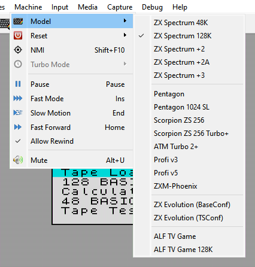
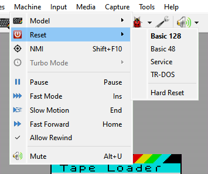

# Machines

```{index} machine
```

```{index} see: profile; machine
```

Xpeccy+ comes with the Sinclair and Amstrad models of the ZX Spectrum, the best-known clones
and the ZX Evolution board. Each one is a complete machine: memory, ROM images, disk
interface, sound and timing are already set as on the real hardware.

## The built-in machines

```{index} machine; built-in, ZX Spectrum 48K, ZX Spectrum 128K, ZX Spectrum +2, ZX Spectrum +2A, ZX Spectrum +3, Pentagon, Pentagon 1024 SL, Scorpion ZS 256, Scorpion ZS 256 Turbo+, ATM Turbo 2+, Profi v3, Profi v5, ZXM-Phoenix, ZX Evolution, ZX Evolution; BaseConf, ZX Evolution; TSConf, BaseConf, TSConf, ALF TV Game, ALF TV Game 128K
```

The machine list shows them in this order, in four groups.

| Machine | Memory | Disk | Notes |
|---|---|---|---|
| **ZX Spectrum 48K** | 48 KB | - | Sinclair's 48K; beeper only; cartridge slot |
| **ZX Spectrum 128K** | 128 KB | - | Sinclair's 128K; AY |
| **ZX Spectrum +2** | 128 KB | - | Amstrad's first model, the gray +2: the 128K with its own ROMs and late ULA timing; AY |
| **ZX Spectrum +2A** | 128 KB | - | Amstrad's later model: Amstrad gate array, four +3 ROMs; AY |
| **ZX Spectrum +3** | 128 KB | +3, two drives | the +2A with a 3-inch disk drive; AY |
| **Pentagon** | 128 KB | Beta Disk | YM, Covox; Kempston mouse and joystick |
| **Pentagon 1024 SL** | 1024 KB | Beta Disk | as the Pentagon; turbo x2 |
| **Scorpion ZS 256** | 256 KB | Beta Disk | AY, Covox; Kempston mouse and joystick |
| **Scorpion ZS 256 Turbo+** | 256 KB | Beta Disk | the Scorpion with the Turbo+ board: SMUC hard disk, turbo x2 |
| **ATM Turbo 2+** | 1024 KB | Beta Disk | YM, Covox; ATM hard disk, Kempston mouse and joystick, turbo x2 |
| **Profi v3** | 512 KB | Beta Disk | version 3 board; AY, Covox; Kempston mouse and joystick, turbo x2 |
| **Profi v5** | 1024 KB | Beta Disk | version 5 board; YM, Covox; Profi hard disk, DD palette, Kempston mouse and joystick, turbo x2 |
| **ZXM-Phoenix** | 2 MB | Beta Disk | YM, Covox; Kempston mouse and joystick, turbo x2 |
| **ZX Evolution (BaseConf)** | 4 MB | Beta Disk | the ZX Evolution board running BaseConf: two YM (TurboSound), Covox; NemoIDE hard disk, SD card, PC keyboard, mouse with wheel, turbo x2 and x4 |
| **ZX Evolution (TSConf)** | 4 MB | Beta Disk | the same board running TSConf; as BaseConf |
| **ALF TV Game** | 64 KB | - | a games console built on the 48K: no AY; cartridges, two joysticks |
| **ALF TV Game 128K** | 128 KB | - | the 128K version of the console; YM |

```{index} Beta Disk, TR-DOS
```

**Beta Disk** is the TR-DOS disk interface; the **+3** has its own drives and +3DOS (see
[Disks and drives](disks.md)).

On the clones and the +3 the disk interface is part of the board, and so are the hard disk
interfaces of the ATM Turbo 2+, the Profi v5 and the ZX Evolution: Options shows them, but
does not let you remove them.

A name with an asterisk after it in the list, such as `Pentagon *`, is a built-in machine
you have changed (see [Your own machines](#your-own-machines)).

## Choosing a machine

```{index} machine; choosing, Model
```

Pick a machine in any of these places:

- **Machine > Model** on the menu bar;
- the {icon}`model-zx48` **Model** button on the toolbar;
- **Model** in the right-click menu over the picture;
- the machine's name in the status bar, with either mouse button;
- **Model** on the **Machine** page of **Options**, then **Apply**.



Switching machines resets the new machine and shows its name over the picture and in the
status bar. The tape and the disks stay in: the tape is rewound to its start. An RZX
recording stops, and the rewind history starts over.

In **Options**, pick the machine first and change its settings after: when **Apply**
switches the machine, what you changed on the **Machine** page is dropped, as it was for
the old machine. Changes on the other pages are applied to the new one. The page then
shows the new machine's settings.

Opening a file can switch the machine too, when the current one cannot run it. See
[Run a program](getting-started.md#run-a-program).

## Machine at start

```{index} Machine at start, Start Machine
```

**Machine at start** on the **Application** page of **Options** sets which machine Xpeccy+
starts with:

- **The last one chosen** - the last machine you picked yourself. A machine that a file
  switched to does not count.
- **Ask** - the **Start Machine** window asks every time.
- one of the machines - always that one.

At the first start you are asked
(see [The first start](getting-started.md#the-first-start)). When a machine or a file is
named on the command line, the question is skipped (see [Command line](command-line.md)).

## Reset

```{index} Reset, Reset; ROM to start from
```

**Machine > Reset** lists where a reset can take the machine: the ROMs it can start from,
such as **Basic 128**, **Basic 48**, **Service** and **TR-DOS**. The one in bold is the ROM
a plain reset starts from. **TR-DOS** is there only when the machine has a Beta Disk
interface.



On the ATM Turbo 2+, the ZX Evolution and the ALF consoles the list holds only **Boots its
own firmware**, grayed out: these machines start their own firmware on every reset.

The {icon}`shutdown` **Reset** button on the toolbar resets the machine when clicked; the
arrow beside it opens the list. **Reset** in the right-click menu works the same way. F12
resets in both hotkey presets.

To change the ROM a plain reset starts from, click the {icon}`settings` **ROM** button on
the **Machine** page of **Options** and mark another ROM (see [ROM images](#rom-images)).

```{index} Hard Reset, power off and on
```

**Hard Reset**, at the end of the list, switches the machine off and on again. The RAM
comes up as the machine's does at power-on, and so does a [divMMC](disks.md#divmmc), which a
reset leaves as it is. The CMOS memory, an EEPROM and the media keep what they hold.

```{index} Reset to 48K, Reset to 128K, Reset to DOS, Reset to Service
```

The **Hotkeys** page of **Options** also has **Reset to 48K**, **Reset to 128K**,
**Reset to DOS**, **Reset to Service** and **Hard Reset**, with no keys set to start with.
On a machine that cannot start from that ROM, the key only shows a short message.

## NMI

```{index} NMI
```

**Machine > NMI** sends a non-maskable interrupt to the CPU. What happens then is up to the
machine's ROM. It does nothing while an RZX recording plays. The key is F10 in the Classic
preset and Shift+F10 in the Modern one. With a [divMMC](disks.md#divmmc) on, it is the
board's NMI button.

## Turbo and speed

```{index} Turbo Mode, turbo, Switch Turbo
```

**Machine > Turbo Mode** lists the turbo steps the machine's board has, with the CPU clock
each one gives, for example **x2 (7 MHz)**. It is grayed out on a machine with no turbo, and
while an RZX recording plays. The **Switch Turbo** hotkey steps through the list.

A board that has a turbo usually lets programs switch the turbo too. Then a program can
change the step you picked, and Xpeccy+ shows the new clock over the picture.

```{index} Speed slider, Overclock, Speed Up, Speed Down
```

**Speed** on the **Machine** page of **Options** is a slider for the whole emulation:

- left of the middle, **Slow Motion 1/2**, **1/4** and **1/8** slow everything down, and the
  frame rate drops with it;
- the middle is **Normal speed**;
- right of the middle, **Overclock x2**, **x4** and **x8** speed the CPU up and keep the
  frame rate.

No real machine ran faster than 14 MHz, so past that the timing of a program is not
guaranteed. The slider is not saved: the next start is at
normal speed. The **Speed Up** and **Speed Down** hotkeys move it too. See also
[Speed and time](time.md).

## The Machine page

```{index} Machine page, Memory
```

**File > Options...** opens **Options**; **Machine** is its first page. At the top:

- **Model** - the machine. The {icon}`settings` gear beside it opens
  **Machine: Advanced Settings**.
- **Memory** - how much RAM the machine has.
- **ROM** - the ROM files in use; the {icon}`settings` button opens **Machine: ROM**.
- **Speed** - the slider described in [Turbo and speed](#turbo-and-speed).
- {icon}`refresh` **Restore machine**, {icon}`save_all` **Save machine...**,
  {icon}`cancel` **Delete this machine** - see [Your own machines](#your-own-machines).

```{index} machine; devices, Covox, Soundrive, General Sound, SAA1099
```

Below them are the machine's devices, in four groups. Each row has a choice and a
{icon}`settings` gear button; the gear opens the rest of that device's settings, in a window
named after it, such as **Machine: Disk**. A gray gear means the device has nothing more to
set. **OK** closes such a window and keeps what you set in it for **Apply**; **Cancel** (or
Esc) puts back what it showed when it opened.

| Group | Row | What it sets |
|---|---|---|
| **Storage** | **Tape** | loading settings; the row shows which are on (see [Tapes](tapes.md)) |
| | **Disk** | **None**, **Beta Disk (WD1793)** or **+3 (uPD765)**; drives and the TR-DOS ROM in its window (see [Disks and drives](disks.md)) |
| | **Hard disk** | the IDE interface; **Master** and **Slave** in its window |
| | **SD card** | ZX Evolution only: the card in use |
| | **divMMC** | 48K, 128K, +2, +2A, +3 and the Pentagons: **None** or **divMMC**; RAM, EEPROM jumper and the firmware in its window (see [divMMC](disks.md#divmmc)) |
| | **Cartridge** | 48K and ALF only: the cartridge in use |
| **Input** | **Joystick** | **None**, **Kempston 5-bit**, **Kempston 8-bit** |
| | **Mouse** | **None** or **Kempston mouse**; sensitivity and wheel in its window |
| | **PC keyboard** | ATM Turbo 2+ and ZX Evolution only: which scan codes the machine gets (see [Keyboard, joystick and mouse](input.md)) |
| **Sound** | **PSG** | the AY/YM chips, from **None** to **x3 - ZX Next**; chip, clock and stereo in its window (see [Sound](sound.md)) |
| | **DAC** | **None**, **Covox only**, **Soundrive 1.05 mode 1** or **mode 2** |
| | **General Sound** | **Off** or **On**; its ROM in its window |
| | **SAA1099** | **Off** or **On** |
| **Board** | **Turbo** | the turbo steps: **x1 (no turbo)**, **x1, x2** or **x1, x2, x4** |
| | **ESP UART** | ZX Spectrum Next only: **Not connected**, **ESP-01 (emulated)** - the Wi-Fi module with Espressif's AT firmware 1.7.6, on this computer's network - or a serial port of this computer with a real module on it. In its window, **Server on the network** lets other computers reach a server the module opens; off, only this computer can, at 127.0.0.1 |
| | **Pi UART** | ZX Spectrum Next only: a serial port of this computer for the Pi's UART |

Changes take effect when you press **Apply** or {icon}`ok-apply` **OK**.

### Advanced settings

```{index} Machine: Advanced Settings, Base clock, Raster layout, Floating bus, Contended memory, contention, ULA snow, ULA plus
```

**Machine: Advanced Settings** holds the settings of the hardware itself, not of how you use
it. Leave them alone unless you know the hardware.

- **CPU** - **Base clock**, the frequency of the crystal the board runs on. The frame rate
  is derived from it too.
- **ULA** - **Raster layout** (the size of the frame and where the interrupt falls in it),
  **ULA pattern**, **Floating bus**, **Ear input**, and check boxes for **Contended memory**,
  **Contended I/O**, **Early timings**, **4T border**, **ULA snow...**,
  **...and it crashes**, **MIC in the beeper** and **ULA plus**.
- **Board** - **Even M1** (Scorpion ZS 256) and **DD palette** (Profi).

Each one is explained beside it, or in a tooltip when you hold the mouse over it.

## Your own machines

```{index} machine; your own, Save machine, Restore machine, Delete this machine, machines folder
```

A change you make to a machine stays with that machine. It is saved when you apply it and
when you switch to another machine, so when you come back to that machine, you find it as
you left it. Each machine keeps its own: memory, the ROM set and the marked ROM, base clock,
turbo steps, the **Advanced settings**, and its devices - disk interface and number of
drives, hard disk interface, PSG, DAC, General Sound, SAA1099, joystick, mouse and PC
keyboard. The other settings on the page, such as the tape settings, are the same for every
machine.

A built-in machine you have changed gets an asterisk after its name. It still gets the
fixes that a new version of Xpeccy+ brings, in every setting you did not change.

The three buttons on the **Machine** page:

- {icon}`save_all` **Save machine...** saves the current settings as a new machine under a
  name you give (Xpeccy+ suggests the machine's name with `(mine)` after it). The new
  machine appears in the machine list and runs at once. It is based on the machine it was
  made from, so it too gets that machine's fixes in every setting you did not change. The
  name must be one no other machine has.
- {icon}`refresh` **Restore machine** undoes every change. A built-in machine goes back to
  its original settings; one of your own goes back to the settings of the machine it was
  made from, and stays in the list.
- {icon}`cancel` **Delete this machine** removes a machine of your own, after asking, and
  switches to the one it was made from. Built-in machines cannot be deleted: use
  **Restore machine**.

Each machine you have changed or made is a small text file in the `machines` folder of the
settings folder (see [Where the settings are](getting-started.md#where-the-settings-are)).
It holds only what differs from the machine it is based on. Deleting the file of a built-in
machine, with Xpeccy+ closed, does the same as **Restore machine**.
{icon}`save_all` **Export settings...** on the **Application** page exports your own
machines together with the settings.

## ROM images

```{index} ROM image, roms folder, Machine: ROM, Font
```

The ROM images are in the `roms` folder of the settings folder. Xpeccy+ comes with every
image its machines need. The images come under their own license terms: `LICENSE` and
`PROVENANCE.md` in the same folder say where each one came from.

To replace a ROM for every machine that uses it, put your file into `roms` under the same
name. On Linux and macOS a new version of Xpeccy+ adds the images it is missing but never
overwrites one that is already there, so your file stays.

To give one machine a different ROM, click the {icon}`settings` **ROM** button on the
**Machine** page. The **Machine: ROM** window lists the machine's ROM banks, named after
what is in each, such as **ROM 0 (Basic 128)**:

- pick a file from the list, which holds every `.rom` and `.bin` file in the `roms` folder;
- or click the {icon}`fileopen` folder button beside it to pick a file from any folder;
- mark the bank a plain reset starts from (**Boots from the marked ROM**).

**Font** is the text-mode font, for the machines that have one. The General Sound ROM is in
the **Machine: General Sound** window, and the TR-DOS ROM in **Machine: Disk**.

```{index} Expert settings, Machine: ROM Files, Romset Editor
```

{icon}`settings` **Expert settings** opens **Machine: ROM Files**, the same ROM set shown
file by file: where each part starts in its file, how much of it is read, and where it is
placed in the machine's ROM. Its buttons {icon}`add` add a file, {icon}`edit` edit or
{icon}`cancel` remove the one selected, and {icon}`lamp` fill the set with the machine's
standard ROMs again. Adding or editing opens the **Romset Editor** with **File**,
**File offset**, **Size** (0 reads to the end of the file) and **ROM pos**, all in KB.

The new ROM is in place when you press **Apply**. Reset the machine to start from it.
