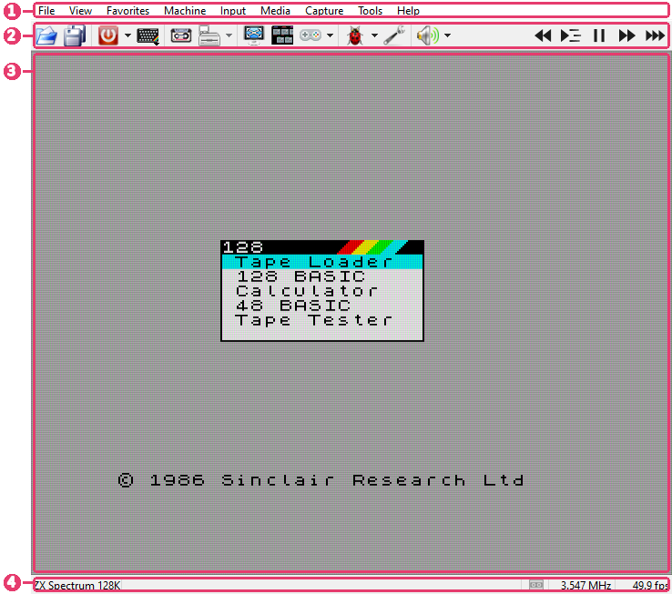
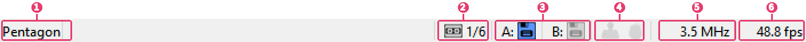
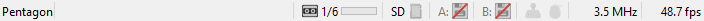
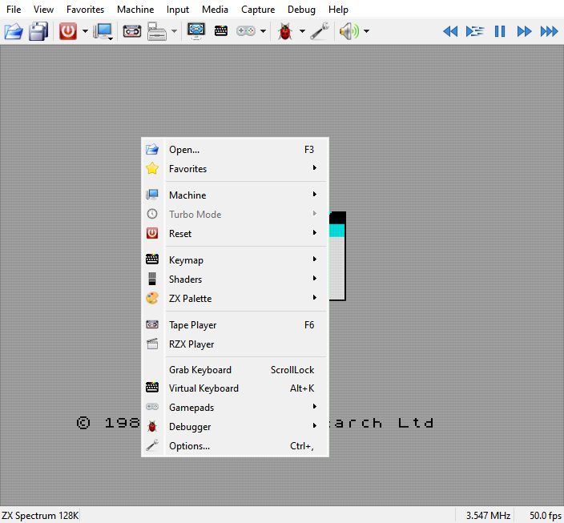

# The main window

```{index} main window
```



1. **Menu bar** - every command, with its key beside it.
2. **Toolbar** - the commands you use most, one click away.
3. **Picture** - the machine's screen. Short messages from the program appear in its
   lower left corner and fade away.
4. **Status bar** - the machine, its tape and drives, speed.

## Menu bar

```{index} menu bar
```

| Menu | What is in it |
|---|---|
| **File** | open and save files, recent files, quick save and load, **Options** |
| **View** | window size, border, fullscreen, shaders and palette, toolbar and status bar, virtual keyboard, input overlay |
| **Favorites** | files you keep at hand |
| **Machine** | which machine runs, reset, turbo, pause, fast mode, slow motion, fast forward, rewind |
| **Input** | keyboard and mouse grab, keymaps, gamepads |
| **Media** | tape player, disk manager, floppy drives, cartridge, SD card, hard disks |
| **Capture** | screenshots, video and sound recording, RZX |
| **Tools** | **Cheats**, the **Debugger** and its windows |
| **Help** | this manual, the project page, what is new, reporting a problem |

A command that has a key shows it in the menu. The keys are set on the **Hotkeys** page of
**Options**.

## Toolbar

```{index} toolbar, toolbar; customizing, Restore Default Buttons, Icon Size, Lock Toolbar
```

By default the toolbar has {icon}`fileopen` **Open**, {icon}`save_all` **Save**,
{icon}`shutdown` **Reset**, {icon}`model-zx48` **Model**, {icon}`tape` **Tape Player**,
{icon}`fdd_disk` **Disk Manager**, {icon}`fullscreen-16` **Fullscreen**,
{icon}`vkeys` **Virtual Keyboard**, {icon}`gamepad` **Gamepads**, {icon}`bug` **Debugger**,
{icon}`other` **Options** and {icon}`speaker` **Mute**, and at the right end
{icon}`time-rewind` **Rewind**, {icon}`time-slow` **Slow Motion**,
{icon}`time-pause` **Pause**, {icon}`time-ffwd` **Fast Forward** and
{icon}`time-fast` **Fast Mode**.

Right-click the toolbar to change it:

- **Buttons** - every command that can be a button, by group; tick the ones you want.
- **Remove** - removes the button you right-clicked.
- **Add Separator Here**, **Add Space Here** - a line or a gap between groups.
- **Icon Size** - 16 x 16 or 24 x 24.
- **Restore Default Buttons** - back to the set above.
- **Lock Toolbar** - on by default, so a slip of the mouse moves no button.
- **Hide Toolbar** - **View > Toolbar** brings it back.

To move a button, untick **Lock Toolbar** and drag the button.

```{index} Mute, volume
```

The arrow beside **Mute** opens a volume slider. Alt with the mouse wheel over the picture
changes the volume too.

## Status bar

```{index} status bar, status bar; tape, status bar; drive lights
```



1. the name of the running machine; a click or a right-click on it opens the list of
   machines;
2. {icon}`tapeGreen` **tape** - the tape light, the block being played (`3/7`) and how far
   the tape is through that block;
3. {icon}`diskGreen` **A: B: C: D:** - a light for each floppy drive the machine has;
4. {icon}`joystick` **joystick** and {icon}`mouse` **mouse** - lit while the running
   program reads them;
5. the CPU clock in MHz;
6. frames per second, or **paused**.

The tape and the drives light up the same way: dim - nothing is in, gray - a tape or a disk
is in, green - reading, red - writing. While it reads or writes, a light blinks: the tape's
between its color and a brighter one all the time it moves, a drive's each time its head
steps to another track.

Hold the mouse over the tape or a drive to see which file is in it. A click opens the
**Tape Player** or the **Disk Manager**; a right-click opens a short menu of the same
commands - play, rewind, open, eject.



While a [divMMC](disks.md#divmmc) is on, the {icon}`sdcard` **SD** light is the light of its
cards - dim with no card in, blue with one, green while one is read, red while one is
written - and either button on it
opens a menu of its cards. The board itself is switched off from the **Media** menu. The
drives are out of the machine then:
their lights are dim and struck through.

## The picture

```{index} right-click menu
```

```{index} see: context menu; right-click menu
```



A right-click on the picture opens a menu with the commands needed while playing: open a
file, favorites, machine, turbo, reset, keymap, shaders, palette, the media windows, grab
keyboard, virtual keyboard, gamepads, **Tools** (**Cheats** and the **Debugger**) and
**Options**. Some of its items act on a click as well as opening their submenu: **Reset**
resets the machine, **Disk Manager** and **Gamepads** open their windows.

- Drop a file onto the picture to open it (see [Run a program](getting-started.md#run-a-program)).
- A click with the middle button grabs the mouse for a program that uses one; another
  click lets the mouse go.
- Alt with the mouse wheel changes the volume.

## Fullscreen

```{index} Fullscreen, Fullscreen; menu bar
```

**View > Fullscreen** hides the menu bar, the toolbar and the status bar. Push the pointer
to the top edge of the screen and hold it there: the menu bar comes down, with the toolbar
if it is shown. They go away again when the pointer leaves them. On macOS the menu is in
the system menu bar, as usual.
