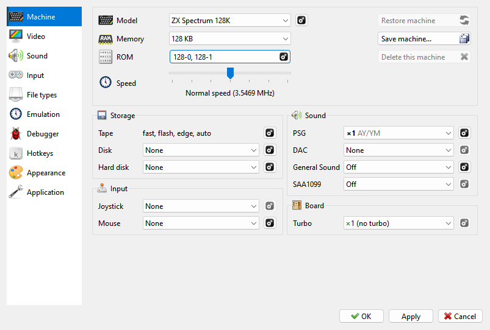
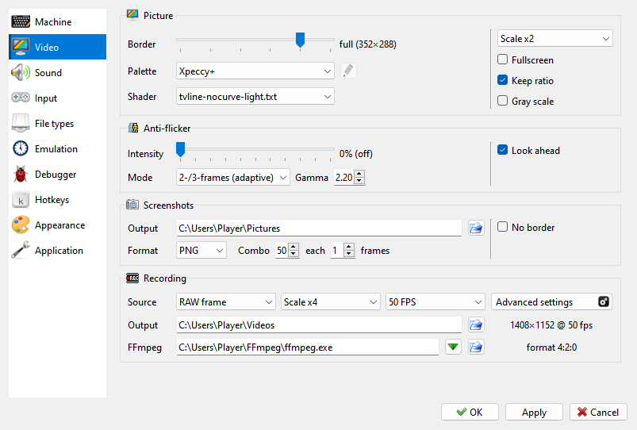
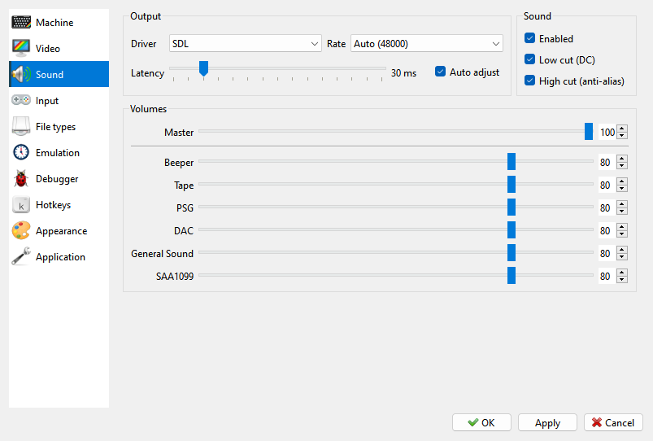
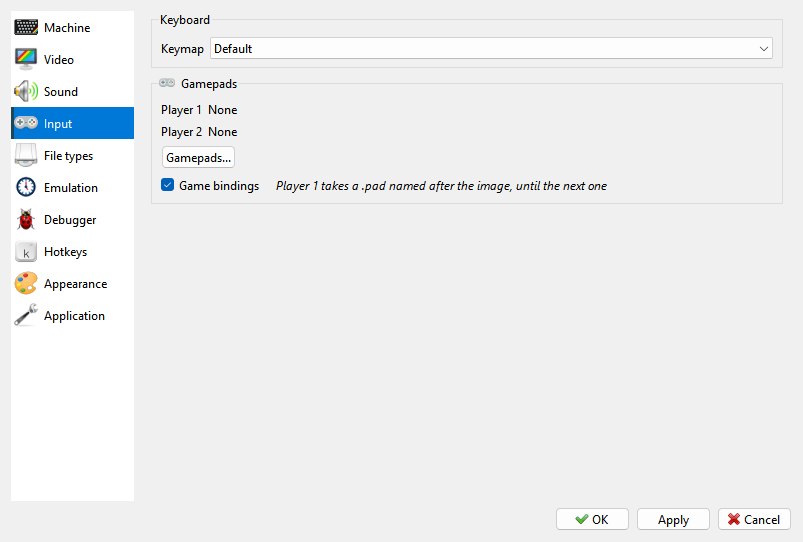
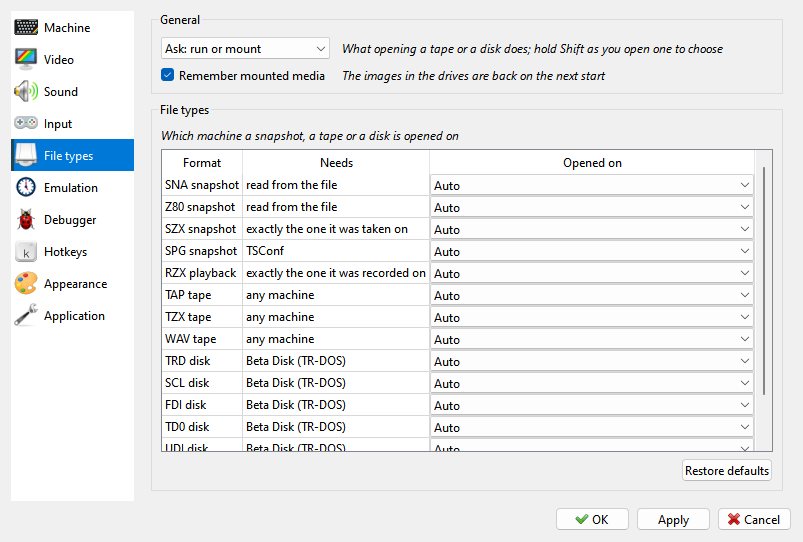
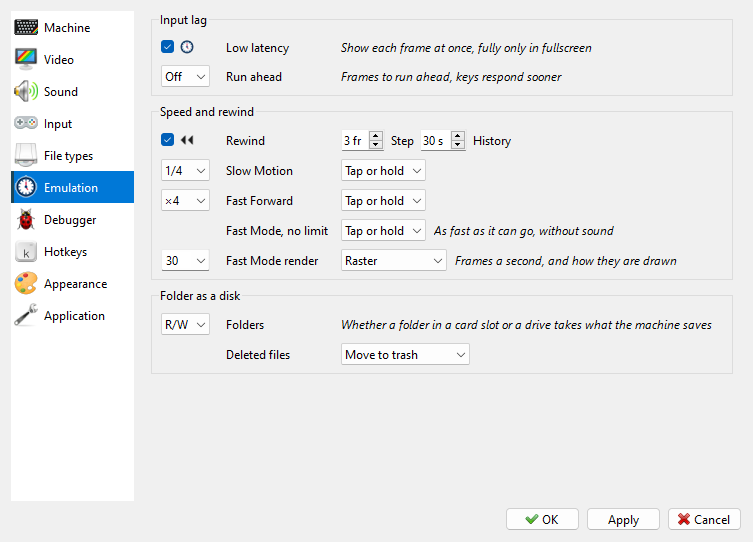
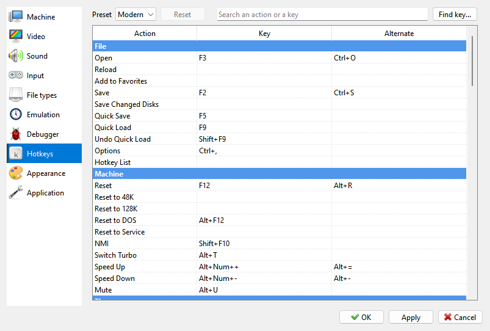
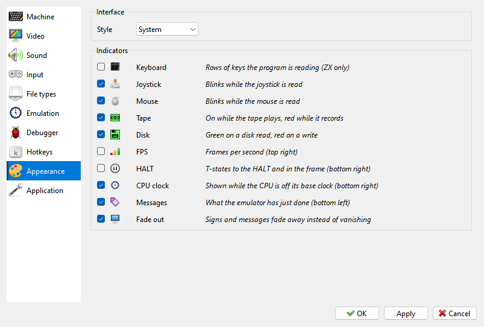
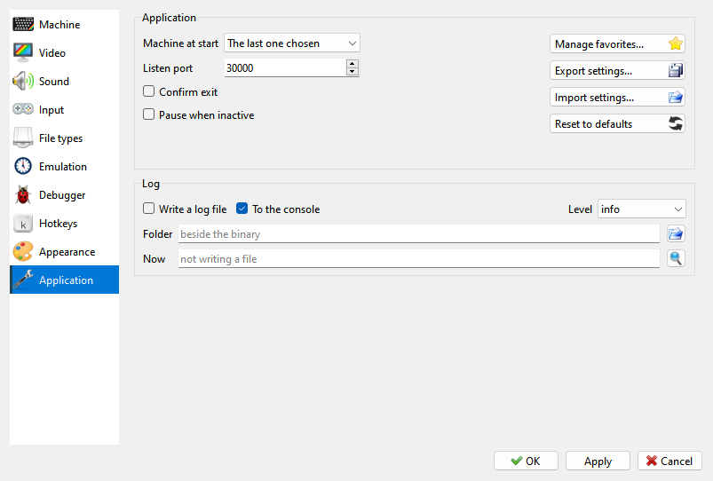

# Options

```{index} Options
```

```{index} see: preferences; Options
```

**File > Options...** opens the settings. The pages are listed on the left; this chapter
says what each one holds and where the manual explains it.

{icon}`ok-apply` **OK** applies the changes and closes the window, **Apply** applies them
and keeps it open, {icon}`cancel` **Cancel** discards them. Hold the mouse over a setting to
see what it does.

## Machine

```{index} Machine page
```



This page sets up the running machine: **Model**, **Memory**, **ROM** and the **Speed**
slider at the top, then its devices in four groups - **Storage**, **Input**, **Sound** and
**Board**. The {icon}`settings` gear beside a device opens the rest of its settings. See
[The Machine page](machines.md#the-machine-page).

What you change here is kept for this machine only. {icon}`save_all` **Save machine...**,
{icon}`refresh` **Restore machine** and {icon}`cancel` **Delete this machine** are explained
in [Your own machines](machines.md#your-own-machines).

## Video

```{index} Video page
```



- **Picture** - border size, palette, shader, window size, fullscreen, gray scale. See
  [Picture](picture.md).
- **Anti-flicker** - see [Anti-flicker](picture.md#anti-flicker).
- **Screenshots** - see [Screenshot settings](capture.md#screenshot-settings).
- **Recording** - video recording through FFmpeg. See [Recording settings](capture.md#recording-settings).

## Sound

```{index} Sound page
```



**Output** (driver, rate, latency), the filters, and the volume of each sound source. See
[The Sound page](sound.md#the-sound-page). The sound chips themselves are set on the
**Machine** page.

## Input

```{index} Input page
```



The keymap; the gamepads of **Player 1** and **Player 2**, with the **Gamepads...** button
that opens their window; and **Game bindings**.
See [Keyboard, joystick and mouse](input.md).

## File types

```{index} File types page
```



What opening a tape or a disk does - run it, mount it, or ask - and whether the media in
the drives come back at the next start. The table says which machine each kind of file
opens on. See [Which machine opens a file](files.md#which-machine-opens-a-file).

## Emulation

```{index} Emulation page
```



- **Input lag** - **Low latency** and **Run ahead**. See [Input lag](time.md#input-lag).
- **Speed and rewind** - how far back rewind goes, how the keys of Slow Motion, Fast
  Forward and Fast Mode work, and what Fast Mode shows. See [Speed and time](time.md).
- **Folder as a disk** - whether a folder used as a card or a disk takes what the machine
  writes, and where a file it deletes there goes. See
  [Writing to a folder](disks.md#writing-to-a-folder).

## Debugger

```{index} Debugger page
```


The font, the colors and what the Debugger shows. See [The Debugger page of Options](debugger.md#the-debugger-page-of-options).

## Hotkeys

```{index} Hotkeys page
```



The keys of every command, in the Modern or Classic preset or one of your own. See
[Hotkeys](hotkeys.md).

## Appearance

```{index} Appearance page, Style, interface style
```



- **Interface** - **Style**: **System** (the look of your system) or one of seven bundled
  styles.
- **Indicators** - which signs are shown over the picture. See
  [Indicators on the picture](picture.md#indicators-on-the-picture).

## Application

```{index} Application page, Listen port, Confirm exit, Export settings, Import settings, Reset to defaults, log, log file
```



- **Machine at start** - see [Machine at start](machines.md#machine-at-start).
- **Listen port** - the network port the program listens on, for tools that control it.
- **Confirm exit** - ask before closing.
- **Pause when inactive** - pause the machine while the window is in the background. See
  [Pause](time.md#pause).
- {icon}`star` **Manage favorites...** - see [Favorites](files.md#favorites).
- {icon}`save_all` **Export settings...**, {icon}`fileopen` **Import settings...** - keep all
  your settings, your own machines included, in one file, and bring them back.
- {icon}`refresh` **Reset to defaults** - puts every setting back to its default value. Your
  own machines stay.
- **Log** - a log file of what the program does, for reporting a problem: **Write a log
  file**, **To the console**, **Level**, **Folder**.
